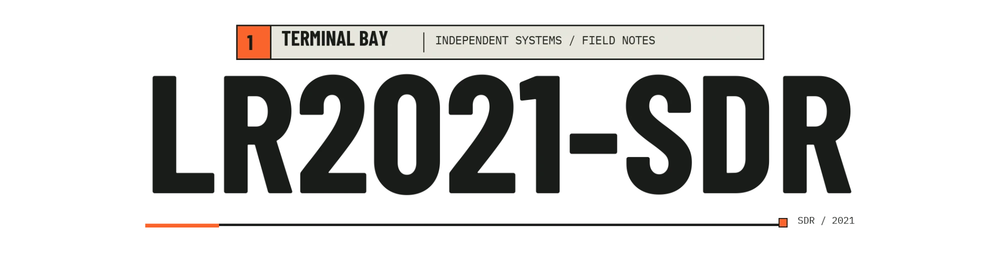
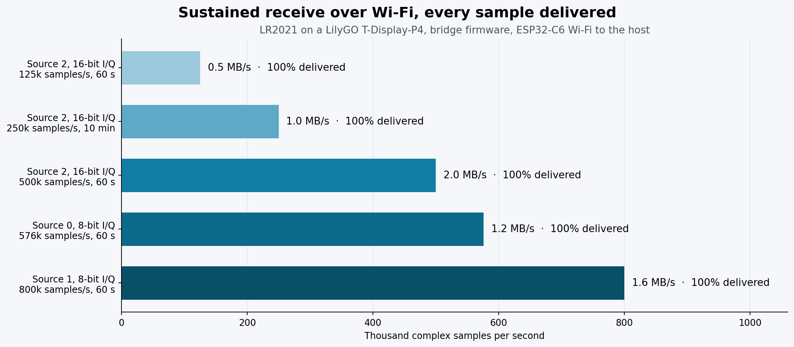
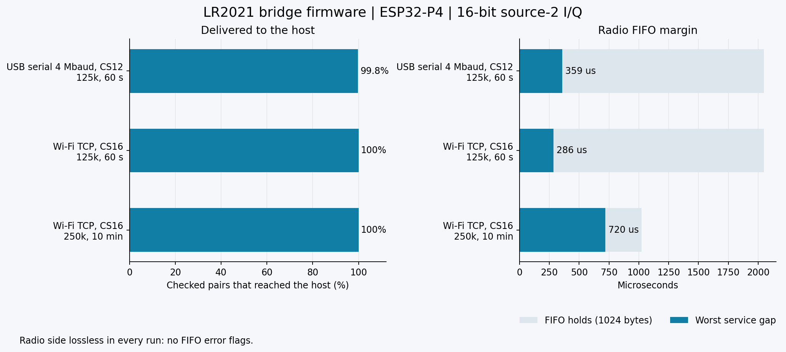
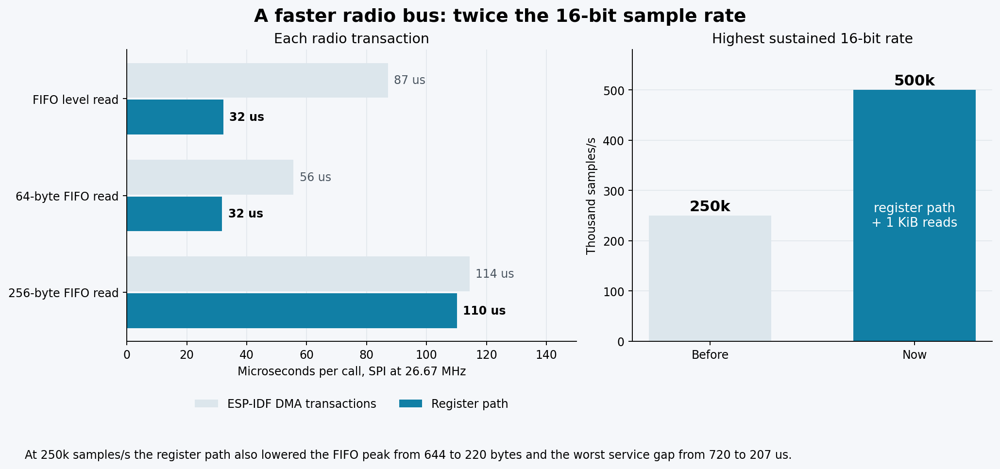
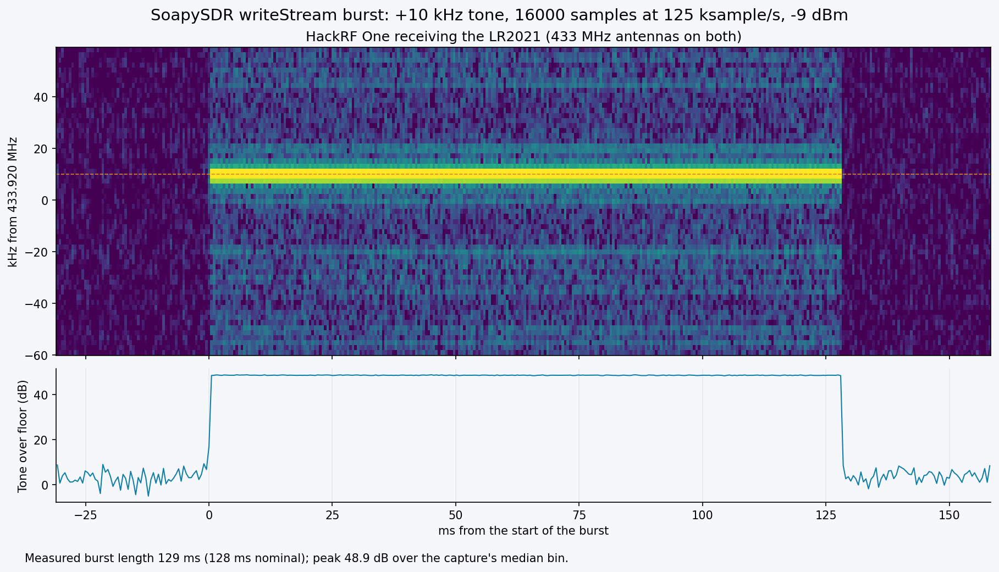

<p align="center">
  <picture>
    <source media="(prefers-color-scheme: dark)" srcset="docs/media/LR2021-SDR-banner-dark.png">
    <source media="(prefers-color-scheme: light)" srcset="docs/media/LR2021-SDR-banner-dark.png">
    
  </picture>
</p>

> **Now MIT licensed.** Use it, fork it, build it into your own products. Just keep the copyright notice. See [LICENSE](LICENSE).

**A LoRa chip that tunes from 100 MHz to 2.74 GHz and streams I/Q at up to 800,000 samples/s.**

P25 voice, pagers, FM, Bluetooth LE and custom transmit from the Semtech LR2021: on a handheld with no SDR dongle, or as an ordinary SoapySDR device on a computer, over USB or Wi-Fi.

[](LICENSE)
[](docs/tx-playback.md#remaining-scope)
[](docs/hardware.md)

[Getting started](docs/getting-started.md) · [Use it as an SDR on a computer](docs/host-sdr.md) · [All guides](docs/README.md) · [LakeShark](https://github.com/SAMS0N1TE/LakeShark)

| | |
| --- | --- |
| **100 MHz to 2.74 GHz** | Continuous receive, well past the datasheet's 150 to 960 MHz and 1.5 to 2.5 GHz. Airband, the top of FM and 2.5 to 2.7 GHz included. |
| **Up to 800,000 samples/s over Wi-Fi** | 16-bit I/Q at 500,000 samples/s and 8-bit I/Q at 576,000 and 800,000 samples/s from the board to a computer, every sample delivered. |
| **SoapySDR on Linux and macOS** | `driver=lr2021` for GNU Radio, SDR++ and other SoapySDR software: timestamps, live gain, retuning, transmit bursts. Rust crates too. |
| **Transmit** | Bursts from SoapySDR `writeStream`, immediate or timed to within microseconds, received at 433.92 and 915 MHz; P25 test bursts, custom waveforms and replayed remotes, confirmed by independent receivers. |
| **P25 Phase 1 voice** | Live calls decoded and played on the handheld. |
| **Bluetooth LE** | The chip's own BLE engine picks up advertising on all three channels. |

[](docs/host-sdr.md#receive)

*Five receive modes, each run for 60 seconds or longer with every sample reaching the computer over the board's Wi-Fi. 250,000 samples/s also ran for 10 minutes.*

[](research/rx-range-and-gain/README.md)

*Every dot is a real signal that moved when the receiver was retuned. Shaded areas are the bands the datasheet promises.*

Measured on one LilyGO T-Display-P4 LR2021 board. The range depends on the module's front end and may differ on other boards or module builds. The bridge firmware drives the radio's SPI bus through the ESP32-P4's registers at 26.67 MHz and reads the FIFO in frames of up to 1,020 bytes. [GNSS and 2.4 GHz](research/gnss-wifi/README.md) and [L76K](research/l76k/README.md) notes cover the signal and GPS-module experiments.

## How it works

The [Semtech LR2021](https://www.semtech.com/products/wireless-rf/lora-plus/lr2021) normally demodulates LoRa, FSK, FLRC and other modes internally. An undocumented command in its ROM hands over the raw baseband instead: 16-bit I and Q samples, with amplitude and phase intact. That turns the chip into an SDR, so receivers can be written in software.

In **LakeShark**, an ESP32-P4 runs those receivers on the LilyGO T-Display-P4: P25 Phase 1 voice, POCSAG pagers and analog FM through the onboard LR2021, with decoding and audio on the handheld. Samples can also be saved for offline analysis.

On a computer, the same board runs this repository's bridge firmware and streams the samples to the host over USB serial or Wi-Fi. The host library and the SoapySDR module turn it into a receive and transmit device; a Linux host can also drive an LR2021 on its own SPI and GPIO lines.

On transmit, the chip has sent P25 test bursts, temperature packets and custom waveforms at 915 MHz and 433.92 MHz. An independent receiver recovered **72 P25 voice frames** from one transmission. Captures go back out too: a Flipper Zero decoded Princeton remote keys replayed by the LR2021, and FSK replays keep their full deviation.

This repository holds the radio access library, the host SDR support (C client, SoapySDR module, Rust crates, simulator), the ESP32-P4 bridge and capture firmware, waveform tools and measurements. **LakeShark provides the live decoders, audio and handheld interface.**

[](https://github.com/SAMS0N1TE/LakeShark)

*LakeShark running on the LilyGO T-Display P4.*

## What you can do

| Feature | What works | Guide |
| --- | --- | --- |
| Stream to a computer | 16-bit I/Q at 125,000 to 500,000 samples/s and 8-bit I/Q at 576,000 or 800,000 samples/s into SoapySDR or rtl_tcp programs, over Wi-Fi or USB serial, with timestamps, live gain and retuning. | [Host SDR](docs/host-sdr.md) |
| Transmit from a computer | I/Q bursts through SoapySDR `writeStream`, immediately or at a device time. | [Host SDR: transmit](docs/host-sdr.md#transmit) |
| Receive on the handheld | P25 Phase 1 voice, POCSAG, and analog FM through the LR2021 in LakeShark. | [Receive](docs/receive.md) |
| Record | Capture raw I/Q for offline decoding, replay, and signal analysis. | [Recording](docs/voice-capture.md) |
| Transmit from the console | Upload and send custom waveforms, and replay OOK and FSK captures. | [Transmit](docs/transmit.md) |

## Start here

- **Use it as an SDR on a computer:** Flash the [bridge firmware](firmware/esp32p4/README.md), then follow the [host SDR guide](docs/host-sdr.md).
- **Use it as a handheld:** Start with [LakeShark](https://github.com/SAMS0N1TE/LakeShark) on the LR2021 version of the LilyGO T-Display P4.
- **Capture I/Q:** Use the firmware's console capture and follow the [getting started guide](docs/getting-started.md).
- **Build with it:** Explore the portable C library and [developer guide](docs/developer-guide.md).
- **Try waveform transmission:** Read the [transmit guide](docs/transmit.md) and [current capabilities](docs/tx-playback.md#remaining-scope).

Tested on **LR2021 ROM 1.24**. See [hardware and setup](docs/hardware.md) for board requirements.

## Use it as an SDR on a computer

A SoapySDR module (`driver=lr2021`) and Rust crates make the LR2021 an ordinary SDR on Linux and macOS: receive from 100 MHz to 2.74 GHz as 16-bit I/Q at 125 to 500 ksample/s or 8-bit I/Q from the chip's other sources at up to 800 ksample/s, with manual gain steps or the chip AGC, timestamps, and half-duplex transmit bursts through `writeStream` on the repository's `0x0293` path. The radio can sit behind the ESP32-P4 bridge firmware on USB serial or Wi-Fi, or on a Linux host's own SPI and GPIO lines; a simulator covers everything without hardware.

On the board's console, join a network once:

```text
wifi set "<ssid>" "<password>"
```

Then from the computer:

```bash
SoapySDRUtil --probe="driver=lr2021,host=192.168.1.50"
```

```bash
SoapySDRUtil --probe="driver=lr2021,serial=/dev/ttyACM0,baud=4000000,format=cs12"
```

Programs that read `rtl_tcp` (SDR++, SDR#, gqrx, OpenWebRX) can receive with it too, on Windows as well, through the `lr2021_tcp` server:

```bash
lr2021_tcp -d serial=COM5,baud=4000000,format=cs12
```

[](firmware/esp32p4/README.md#use-it-from-a-computer)

*Wi-Fi carries 16-bit samples at 250,000/s without loss, and USB serial carries 125,000/s as CS12, a 12-bit packing of the same samples. The radio side was lossless in every run.*

[](firmware/esp32p4/README.md#use-it-from-a-computer)

*The bridge firmware talks to the radio through the ESP32-P4's SPI registers instead of DMA transactions, and reads the FIFO in large frames: each transaction is up to 2.7 times faster, and 16-bit receive doubled from 250,000 to 500,000 samples/s.*

[](docs/host-sdr.md#transmit)

*A burst sent from SoapySDR, received by a HackRF One: the +10 kHz tone at the expected offset, 129 ms long for 16,000 samples at 125,000 samples/s.*

| Check on the LilyGO board | Result |
| --- | --- |
| SoapySDR receive over Wi-Fi, 60 s at 125k, 250k and 576k, 30 s at 500k | No overflows; timestamps step by exactly one sample period |
| 8-bit I/Q at 576,000 samples/s, rate and orientation | A known signal moves 49.99 kHz for a 50.000 kHz retune; the passband reaches ±200 kHz |
| Gain-tagged samples (source 6) | Every sample carries the manual gain step |
| Transmit at 250,000 samples/s, 915 MHz | Burst received for exactly its 64 ms length |
| Live gain change while streaming | No gap; gain step 13 to 3 lowers the level by 38 dB |
| Retune while streaming | One overflow, then data at the new frequency |
| Timed transmit burst 2 s ahead | Started 11 µs after the requested time |
| Transmit during receive | One receive overflow, receive resumes 0.4 s later |

[Install, device arguments, rates, gain and TX limits](docs/host-sdr.md) · [rtl_tcp server](docs/rtl-tcp.md) · [Bridge protocol](docs/bridge-protocol.md) · [Bridge firmware](firmware/esp32p4/README.md) · [SoapySDR module](soapy/README.md) · [Rust crates](rust/README.md) · [udev rules](udev/60-lr2021-sdr.rules)

Hardware results come from a LilyGO T-Display-P4 LR2021 board; the automated tests run against the simulator. [What is tested where](docs/host-sdr.md#measurements-and-tests).

## P25 receive and transmit

Live reception has produced audible P25 Phase 1 calls. A saved recording also decoded back into voice offline.

[](docs/voice-capture.md)

*A one-second call recording at 154.785 MHz. These same samples decoded into 27 IMBE voice frames offline.*

Transmit tests sent P25 voice-data bursts carrying a test tone. An independent receiver recovered **72 voice frames** and reconstructed the expected tone.

[P25 results and setup](docs/p25.md) · [Listen to the recovered TX tone](research/tx-p25/evidence/v13-p25-voice19200/recovered.wav)

## Receiver measurements

### Continuous capture

[](docs/live-streaming.md)

Three separate sessions ran for up to **391 seconds**, with no reported FIFO loss or queue rejection. These runs measure capture continuity while decoder input processing stays active. The bridge firmware has since streamed for 10 minutes at 250,000 samples/s.

[Read the live-streaming results](docs/live-streaming.md)

### Receive range

Retuning tests against the board's own clock harmonics show the receive chain working from **100 MHz to 2740 MHz**, well beyond the datasheet bands.

A second check used a known signal. Inside a shielded enclosure a HackRF One sent one tone 30 kHz above each test frequency, and the LR2021 looked for it, receive only.

| Frequency | Datasheet | Tone over the quiet capture |
| --- | --- | --- |
| 98 MHz | below the LF band | none |
| 100 MHz | below the LF band | 14.5 and 16.3 dB in two runs (the chip flags `IMG_CAL`, samples still carry the tone) |
| 103 MHz | below the LF band | 11.5 dB (`IMG_CAL` flagged) |
| 106 MHz | below the LF band | 15.7 dB |
| 1300 MHz | above the LF band | 37.6 dB |
| 2600 MHz | above the HF band | 35 dB |
| 2740 MHz | above the HF band | 42 dB |
| 2760 MHz | above the HF band | none: `PLL_LOCK`, no samples |

Low band with a VHF whip and the HackRF at TX gain 20; 2600 and 2740 MHz with a 433 MHz antenna and TX gain 0. Levels are relative to the quiet capture. [Method](research/rx-range-and-gain/README.md#shielded-tone-check)

[Range, sample rate, gain and Bluetooth LE results](research/rx-range-and-gain/README.md)

### Packet decode

[](tools/plot_fsk_decode.py)

*One burst from the triggered I/Q recorder in LakeShark, decoded offline: 2400 baud 2-FSK, sync D391 D391, 4-byte payload, CRC-16 checks.*

The recorder waits for a signal 10 dB over the floor and keeps 10 ms from before the trigger, so the whole preamble is in the file. [plot_fsk_decode.py](tools/plot_fsk_decode.py) draws this from any LakeShark `.sub` I/Q capture.

<details>
<summary>Sample rates and known-tone checks</summary>

### Sample rates

[](docs/technical-overview.md#hardware)

Known-tone estimates for four tested bandwidths ranged from about **125,000 to 1,000,000 complex samples per second**. These are short-window measurements. Continuous 16-bit streaming runs at up to **500,000 samples per second** over SPI at 26.67 MHz.

### I/Q orientation

[](docs/technical-overview.md#known-tone-checks)

Separate +25 kHz and −15 kHz RF-offset tones verify frequency direction in the captured I/Q. Spectra are normalized separately, and amplitude is uncalibrated.

[Measurements and setup](docs/technical-overview.md#known-tone-checks)

</details>

## More documentation

- [All guides](docs/README.md)
- [Use the LR2021 as an SDR on a computer](docs/host-sdr.md)
- [Bridge protocol](docs/bridge-protocol.md)
- [ESP32-P4 bridge and capture firmware](firmware/esp32p4/README.md)
- [Hardware and setup](docs/hardware.md)
- [Developer guide](docs/developer-guide.md)
- [Research and measurements](docs/research.md)
- [Transmit capabilities and remaining work](docs/tx-playback.md#remaining-scope)
- [TX sample rate findings and capture replay](docs/tx-playback.md#sample-rate-and-frequency-findings)

## Contact

[support@terminalbay.com](mailto:support@terminalbay.com)

## Credits and license

Inspired by [ESP-SDR](https://github.com/ESPARGOS/esp-sdr) and the ESPARGOS team's work exposing raw radio access. No ESP-SDR code is included.

Original LR2021 capture and hardware integration developed for [LakeShark](https://github.com/SAMS0N1TE/LakeShark).

Licensed under the [MIT License](LICENSE).

For AI-assisted copying, attribution and source-derived reimplementations, see the [AI use policy](AI_USE.md).
