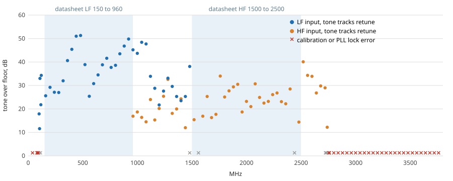
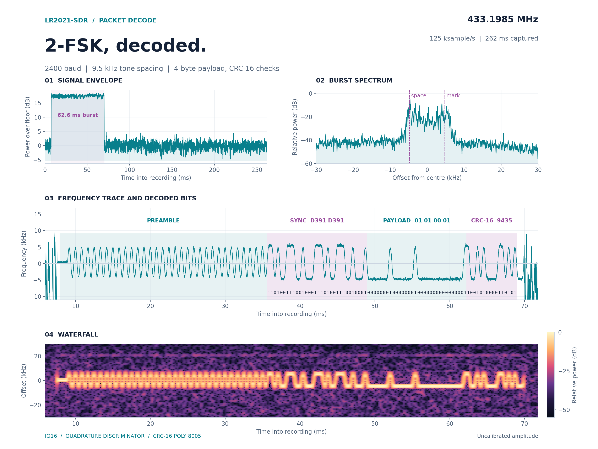

# LR2021-SDR

**A LoRa chip that tunes from 100 MHz to 2.74 GHz and streams 16-bit I/Q.**

P25 voice, pagers, FM, Bluetooth LE and custom transmit from the Semtech LR2021 on a handheld, with no SDR dongle.

[Getting started](docs/getting-started.md) · [All guides](docs/README.md) · [LakeShark](https://github.com/SAMS0N1TE/LakeShark)

| | |
| --- | --- |
| **100 MHz to 2.74 GHz** | Continuous receive, well past the datasheet's 150 to 960 MHz and 1.5 to 2.5 GHz. Airband, the top of FM and 2.5 to 2.7 GHz included. |
| **Up to 250,000 samples/s** | 16-bit I/Q over plain SPI. At 125,000 samples/s it has streamed for over six minutes with no loss. |
| **P25 Phase 1 voice** | Live calls decoded and played on the handheld. |
| **Bluetooth LE** | The chip's own BLE engine picks up advertising on all three channels. |
| **Transmit** | Custom waveforms, P25 test bursts and replayed remotes, confirmed by independent receivers. |

*Every dot is a real signal that moved when the receiver was retuned. Shaded areas are the bands the datasheet promises.*

Measured on one LilyGO T-Display-P4 LR2021 board. The range depends on the module's front end and may differ on other boards or module builds. The 250k rate above is for the standalone firmware's 16-bit source-2 path. The host link is configured for 16 MHz SPI, and that path reads the FIFO with the CPU. A separate experimental LakeShark build reached a higher rate with 8-bit samples and DMA reads, described below.

**Raw-IQ research update:** [sfowlr](https://github.com/sfowlr) reported faster 8-bit export, a source-0 rate converter, gain-order behavior and native four-level FSK on a Meshnology W12 in [LakeShark discussion #16](https://github.com/SAMS0N1TE/LakeShark/discussions/16). Our [receive-only follow-up](research/community-2026-10/README.md) reproduced bounded ~666k-pair/s IQ8 transport on the LilyGO board with large DMA FIFO reads, and found a different gain-register result after `SetRx`. TX scaling and four-level FSK remain untested here. [GNSS and 2.4 GHz](research/gnss-wifi/README.md) and [L76K](research/l76k/README.md) notes cover the separate signal and GPS-module experiments.

## How it works

The [Semtech LR2021](https://www.semtech.com/products/wireless-rf/lora-plus/lr2021) normally demodulates LoRa, FSK, FLRC and other modes internally. An undocumented command in its ROM hands over the raw baseband instead: 16-bit I and Q samples, with amplitude and phase intact. That turns the chip into an SDR, so receivers can be written in software.

In **LakeShark**, an ESP32-P4 runs those receivers on the LilyGO T-Display-P4: P25 Phase 1 voice, POCSAG pagers and analog FM through the onboard LR2021, with decoding and audio on the handheld. Samples can also be saved for offline analysis.

On transmit, the same chip has sent P25 test bursts, temperature packets and custom waveforms at 915 MHz and 433.92 MHz. An independent receiver recovered **72 P25 voice frames** from one transmission. Captures go back out too: a Flipper Zero decoded Princeton remote keys replayed by the LR2021, and FSK replays keep their full deviation.

This repository holds the radio access library, capture firmware, waveform tools and measurements. **LakeShark provides the live decoders, audio and handheld interface.**

*LakeShark running on the LilyGO T-Display P4.*

## What you can do

| Feature | What works | Guide |
| --- | --- | --- |
| Receive | P25 Phase 1 voice, POCSAG, and analog FM through the LR2021 in LakeShark. | [Receive](docs/receive.md) |
| Record | Capture raw I/Q for offline decoding, replay, and signal analysis. | [Recording](docs/voice-capture.md) |
| Transmit | Upload and send custom waveforms through the experimental playback path, and replay OOK and FSK captures. | [Transmit](docs/transmit.md) |

## Start here

- **Use it as a handheld:** Start with [LakeShark](https://github.com/SAMS0N1TE/LakeShark) on the LR2021 version of the LilyGO T-Display P4.
- **Capture I/Q:** Use the standalone capture firmware and follow the [getting started guide](docs/getting-started.md).
- **Build with it:** Explore the portable C library and [developer guide](docs/developer-guide.md).
- **Try waveform transmission:** Read the [transmit guide](docs/transmit.md) and [current capabilities](docs/tx-playback.md#remaining-scope).

The standalone capture firmware records I/Q. Use LakeShark for live decoding, audio, and the handheld UI. The work is experimental and has been tested on **LR2021 ROM 1.24**. See [hardware and setup](docs/hardware.md) for board requirements.

## P25 receive and transmit

Live reception has produced audible P25 Phase 1 calls. A saved recording also decoded back into voice offline.

*A one-second call recording at 154.785 MHz. These same samples decoded into 27 IMBE voice frames offline.*

Transmit tests sent P25 voice-data bursts carrying a test tone. An independent receiver recovered **72 voice frames** and reconstructed the expected tone. This is experimental burst transmission.

[P25 results and setup](docs/p25.md) · [Listen to the recovered TX tone](research/tx-p25/evidence/v13-p25-voice19200/recovered.wav)

## Receiver measurements

### Continuous capture

Three separate sessions ran for up to **391 seconds**, with no reported FIFO loss or queue rejection. These runs measure capture continuity while decoder input processing stays active.

[Read the live-streaming results](docs/live-streaming.md)

### Receive range

Retuning tests against the board's own clock harmonics show the receive chain working from **100 MHz to 2740 MHz**, well beyond the datasheet bands. Below 100 MHz image calibration fails, and above about 2750 MHz the synthesizer does not lock.

A second check used a known signal. Inside a shielded enclosure a HackRF One sent one tone 30 kHz above each test frequency, and the LR2021 looked for it, receive only.

| Frequency | Datasheet | Tone over the quiet capture |
| --- | --- | --- |
| 98 MHz | below the LF band | none |
| 100 MHz | below the LF band | 14.5 and 16.3 dB in two runs (the chip flags `IMG_CAL`, samples still carry the tone) |
| 103 MHz | below the LF band | 11.5 dB (`IMG_CAL` flagged) |
| 106 MHz | below the LF band | 15.7 dB |
| 1300 MHz | above the LF band | 37.6 dB |
| 2600 MHz | above the HF band | 35 dB |
| 2740 MHz | above the HF band | 42 dB |
| 2760 MHz | above the HF band | none: `PLL_LOCK`, no samples |

Low band with a VHF whip and the HackRF at TX gain 20; 2600 and 2740 MHz with a 433 MHz antenna and TX gain 0. Levels are relative, not a sensitivity figure. [Method](research/rx-range-and-gain/README.md#shielded-tone-check)

[Range, sample rate, gain and Bluetooth LE results](research/rx-range-and-gain/README.md)

### Packet decode

*One burst from the triggered I/Q recorder in LakeShark, decoded offline: 2400 baud 2-FSK, sync D391 D391, 4-byte payload, CRC-16 checks.*

The recorder waits for a signal 10 dB over the floor and keeps 10 ms from before the trigger, so the whole preamble is in the file. [plot_fsk_decode.py](tools/plot_fsk_decode.py) draws this from any LakeShark `.sub` I/Q capture.

Sample rates and known-tone checks

### Sample rates

Known-tone estimates for four tested bandwidths ranged from about **125,000 to 1,000,000 complex samples per second**. These are short-window measurements, not continuous-streaming rate limits. Clean captures run at up to **250,000 samples per second**; faster rates overflow the chip FIFO because the 16 MHz SPI bus cannot carry them.

### I/Q orientation

Separate +25 kHz and −15 kHz RF-offset tones verify frequency direction in the captured I/Q. Spectra are normalized separately, and amplitude is uncalibrated.

[Measurements and setup](docs/technical-overview.md#known-tone-checks)

## More documentation

- [All guides](docs/README.md)
- [Hardware and setup](docs/hardware.md)
- [Developer guide](docs/developer-guide.md)
- [Research and measurements](docs/research.md)
- [Transmit capabilities and remaining work](docs/tx-playback.md#remaining-scope)
- [TX sample rate findings and capture replay](docs/tx-playback.md#sample-rate-and-frequency-findings)

## Contact

[support@terminalbay.com](mailto:support@terminalbay.com)

## Credits and license

Inspired by [ESP-SDR](https://github.com/ESPARGOS/esp-sdr) and the ESPARGOS team's work exposing raw radio access. No ESP-SDR code is included.

Original LR2021 capture and hardware integration developed for [LakeShark](https://github.com/SAMS0N1TE/LakeShark).

Licensed under [GPL-3.0](LICENSE).
