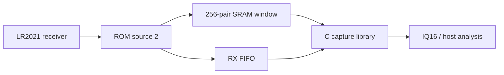
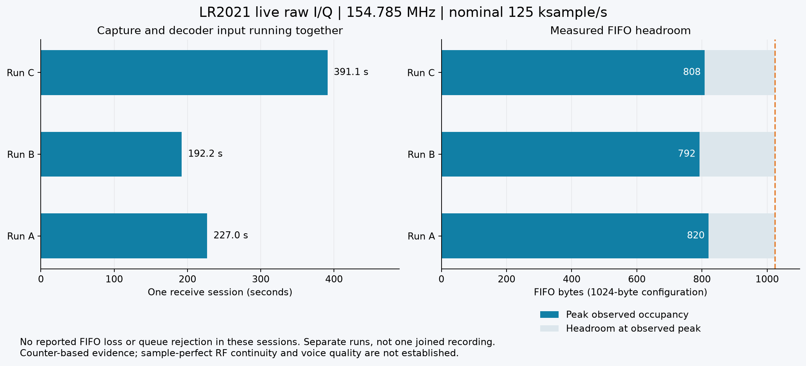
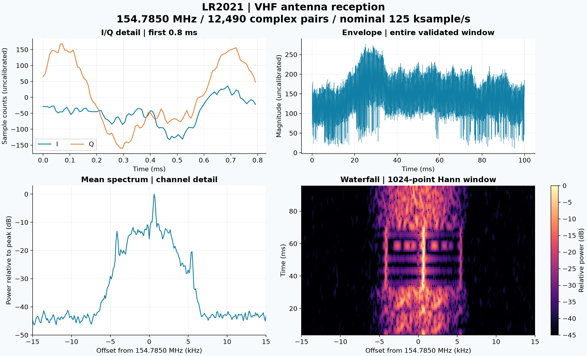

<h1 align="center">LR2021-SDR</h1>

<p align="center">Raw I/Q from the LR2021</p>

<p align="center">
  <a href="#start-here">Start here</a> |
  <a href="docs/porting.md">Porting</a> |
  <a href="docs/protocol.md">Protocol</a> |
  <a href="https://github.com/SAMS0N1TE/LakeShark">LakeShark</a>
</p>

Experimental raw I/Q capture for the Semtech LR2021, written in C11.
Captures receiver I/Q through an undocumented ROM path, with a
portable radio interface and native host tools.

> [!IMPORTANT]
> **Experimental, receive-only.** LR2021 ROM **1.24** is the supported target.
> LakeShark's live integration has sustained capture without reported FIFO loss.
> This portable library has host tests and needs a board adapter. Independent
> RF continuity and raw-I/Q voice quality remain unverified.

## Start here

**[Build the C tools](#build)** | **[Connect your driver](docs/porting.md)** | **[Console format](docs/console.md)**

1. **Check the radio:** LR2021, ROM 1.24, with SPI, BUSY and reset access.
2. **Build the library and tools:** CMake and a C11 compiler; MinGW-w64 on Windows.
3. **Capture a window:** supply the board hooks, configure LoRa RX, then use the
   capture API or a compatible console. See [capture.c](examples/capture.c).

## Capture and analysis

- 256-pair SRAM capture with verified memory restoration.
- Bounded FIFO capture, up to 250 ms at a nominal 125 ksample/s.
- IQ16 decoding, capture validation, tone measurement and sample-rate estimation.
- Windows serial burst capture and portable log conversion.
- Checked-session API, bounded queue and offline ROM tools.
- LakeShark live I/Q capture and decoder-input processing ran for 391 seconds
  without reported FIFO loss or queue rejection. See
  [live streaming results](docs/live-streaming.md) and
  [portable capture API](docs/continuous.md).



### Sustained live capture



Three separate live sessions ran for 227, 192 and 391 seconds with no reported
FIFO loss or queue rejection. LakeShark now captures and processes I/Q in
parallel, removing the former pauses between 250 ms windows. The graph shows
driver measurements, not a simulation or an RF waveform. Independent
sample-continuity and voice-quality tests remain open.
[Results and reproducible graph](docs/live-streaming.md).

### Live P25 reception

**Live P25 Phase 1 C4FM voice reception is confirmed in LakeShark using the
onboard LR2021 at 154.7850 MHz.** The listener confirmed audible voice with a
VHF antenna. Receiver telemetry showed:

| Observation | Result |
| --- | --- |
| Selected receiver | LR2021 |
| Sync detections | 67 |
| Voice frames | 53 |
| BCH checks passed / failed | 68 / 89 |
| Read errors / audio drops | 0 / 0 |

This demonstrates the original LakeShark integration's FSK receive path and
P25 decoder. It does not establish voice decoding through this library's
experimental raw-I/Q path. Audio quality has not been measured.

### Captured signals



Over-the-air reception at **154.7850 MHz** with a VHF antenna. This 12,490-pair
window passed export CRC, FIFO continuity and radio recovery checks. Time and
frequency axes use the nominal 125 ksample/s rate; amplitude is uncalibrated.
The figure shows the validated RF recording with a closer I/Q view, full-window
envelope and channel detail. It is a separate capture from the live voice
confirmation above; no audio was decoded from this plotted window.

### Known-tone checks


Real source-2 captures at 910.525 MHz, SF7, BW62.5 kHz. The left panel shows
80 I/Q pairs from a +25 kHz tone; the right compares separate 256-pair captures
at +25 and -15 kHz. Spectra use a Hann window, DC removal and separate peak
normalization. Amplitude is uncalibrated.

## Hardware

LR2021 with ROM firmware **1.24**, SPI, BUSY and reset access. Configure LoRa
RX before capture. The original implementation was tested with an ESP32-P4
host; this standalone extraction has host tests only. Supply the board hooks
described in [Porting](docs/porting.md). No board firmware binary is provided.

| Capture | Output | Rate |
| --- | --- | --- |
| SRAM | 256 complex int16 pairs | Profile dependent |
| FIFO | 1..250 ms, with gaps between sessions | Nominal 125 ksample/s at BW31.25 kHz |
| Checked FIFO | 1..60000 ms per portable API session | Nominal 125 ksample/s at BW31.25 kHz |

LakeShark's live task integration runs until stopped; it is separate from the
portable API's duration limit.

Known-tone tests at 910.525 MHz, SF7 measured rates near 4 times LoRa bandwidth
for 31.25, 62.5, 125 and 250 kHz bandwidths. I occupies the low signed halfword,
Q the high halfword; positive RF offset produces positive frequency for I+jQ.
Other profiles need measurement. See [Protocol](docs/protocol.md).


Known-tone estimates follow 4 times the configured bandwidth within about
0.5% for the tested profiles. These are short-window rate measurements, not
a measure of continuous FIFO throughput.

## Build

Requires CMake 3.18+ and a C11 compiler. Windows builds use MinGW-w64.

```sh
cmake -S . -B build
cmake --build build
ctest --test-dir build --output-on-failure
cmake --install build --prefix install
```

Link `lr2021_iq` for radio capture and `lriq` for parsing and measurement.
Both libraries use caller-owned storage. See [capture.c](examples/capture.c).

## Tools

```sh
lriq_tool capture COM3 capture 10
lriq_tool analyze capture-0000.bin
lriq_tool unpack-fifo capture.log capture.iq16
```

`capture` requires Windows and firmware implementing `lora lrcap`. Select the
correct port; it opens at 115200 baud without resetting the board. Count 0
repeats until Ctrl+C. Bursts produce binary, CSV and metadata files.

`analyze` reads one 1024-byte SRAM window. `unpack-fifo` validates one compact
console transaction before saving interleaved little-endian IQ16. Existing
output files are preserved. [Console format](docs/console.md) describes the
firmware interface and signal-level trigger.

## Limitations

- Undocumented source routing, restricted to LR2021 ROM 1.24.
- Active PRAM patches and conflicting radio sessions are refused.
- Capture interrupts normal reception and resets the radio during recovery.
- FIFO windows can overflow, including with internal RAM. Any capture or
  recovery error invalidates the output; continuous lossless reception is unproven.
- P25 Phase 1 C4FM and CQPSK control frames decoded from qualified synthetic RF
  captures in the original integration. Live Phase 1 C4FM voice is confirmed
  through LakeShark's FSK path. Raw-I/Q voice decoding, measured audio quality
  and Phase 2 are not established. A P25 decoder is not included.

## Take it handheld

<p align="center">
  <a href="https://github.com/SAMS0N1TE/LakeShark">
    <picture>
      <source media="(prefers-color-scheme: dark)" srcset="https://github.com/user-attachments/assets/657f79dc-afd4-4943-89b3-d9b215a7cb09">
      
    </picture>
  </a>
</p>

**LakeShark puts the radio workbench in your hand.** P25, aircraft tracking,
pagers, LoRa tools and offline maps on the LilyGO T-Display P4. Explore the
supported boards, see it running, and find the setup guides.

<p align="center">
  <a href="https://github.com/SAMS0N1TE/LakeShark"><b>Get LakeShark</b></a> |
  <a href="https://terminalbay.com/?m=lakeshark-showcase"><b>See it in action</b></a> |
  <a href="https://terminalbay.com/?m=wiki"><b>Setup guides</b></a>
</p>

## Standing on

| Project | Credit |
| --- | --- |
| [ESP-SDR](https://github.com/ESPARGOS/esp-sdr) | The ESPARGOS team's work exposing undocumented raw I/Q capture on ESP32 radios inspired this LR2021 investigation. Their project was the starting point for exploring a similar path on the LR2021. |
| [LakeShark](https://github.com/SAMS0N1TE/LakeShark) | Original LR2021 capture implementation and ESP32-P4 hardware integration. |

ESP-SDR is credited for the inspiration and published work; no ESP-SDR code is
included here. LR2021-SDR is [GPL-3.0](LICENSE).
