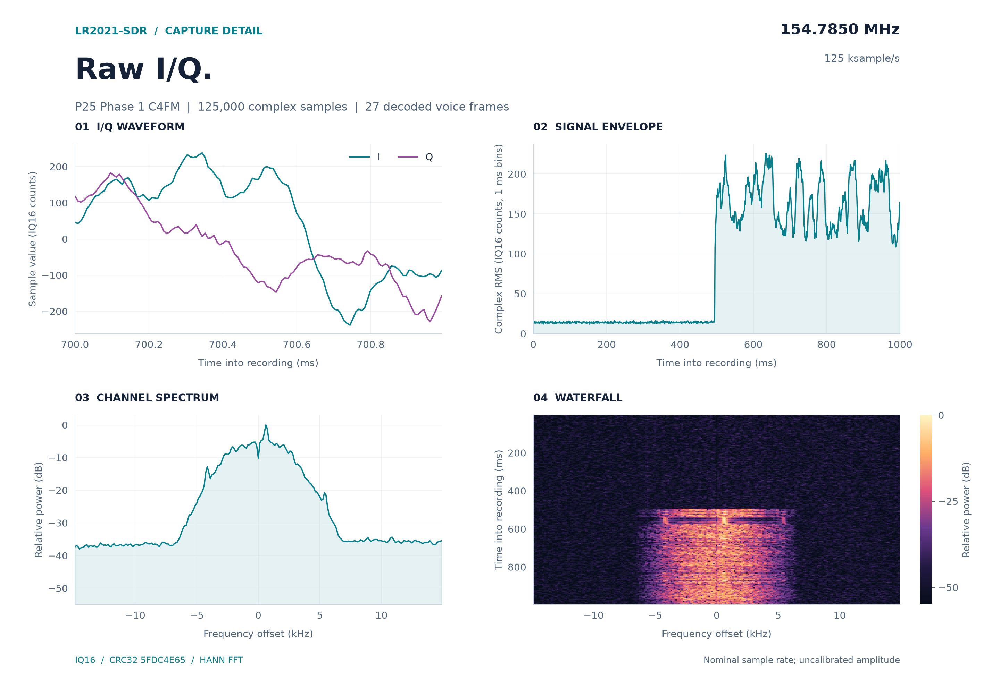
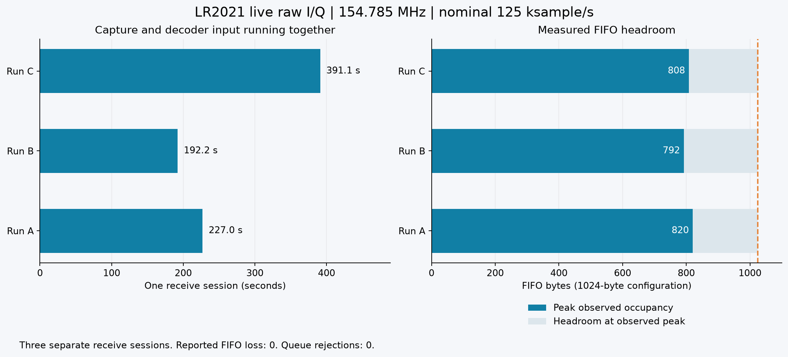
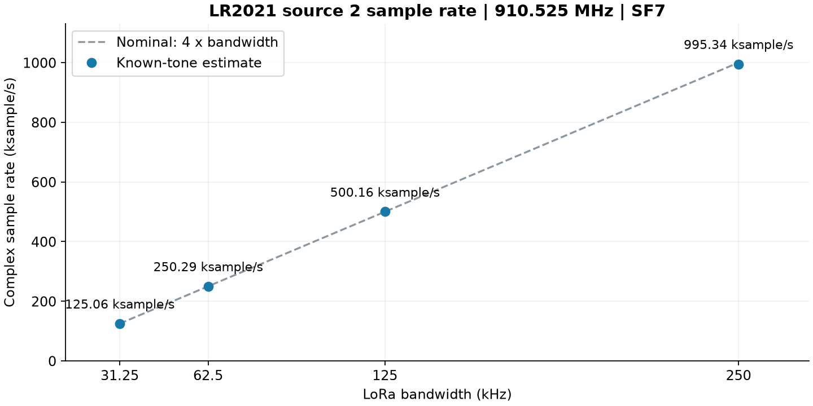
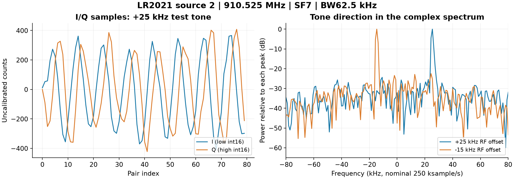

# LR2021-SDR

**A LoRa chip that turns into a 16-bit I/Q SDR.** P25 voice, POCSAG, analog FM, and waveform transmission at 150–960 MHz or 1.5–2.5 GHz.
update - potentially coukd expand 104 MHz to 2,750 MHz

[Getting started](docs/getting-started.md) · [All guides](docs/README.md) · [LakeShark](https://github.com/SAMS0N1TE/LakeShark)

LR2021-SDR gives software access to raw I/Q samples from the [Semtech LR2021](https://www.semtech.com/products/wireless-rf/lora-plus/lr2021), turning its receiver into an SDR. It also includes an experimental transmit path for sending custom waveforms.

The chip already supports LoRa, FSK, FLRC, and several other radio modes. Its low-frequency path covers **150–960 MHz**, and its high-frequency path covers **1.5–2.5 GHz**. Normally, it handles modulation and demodulation internally. Raw I/Q access gives us the signal samples themselves, including amplitude and phase information, so we can build our own receivers in software.

In **LakeShark**, this powers P25 Phase 1 voice, POCSAG pager reception, and analog FM through the onboard LR2021. An ESP32-P4 handles decoding and audio directly on the handheld, without an external SDR dongle. Samples can also be saved for offline decoding and analysis.

On transmit, experiments have sent P25 test-tone bursts, temperature packets, and custom waveforms at 915 MHz and 433.92 MHz. An independent receiver recovered **72 P25 voice frames** from one test transmission and reconstructed the expected tone. Received captures can also be sent back out: a Flipper Zero decoded Princeton remote keys replayed by the LR2021, and FSK replays keep their full deviation.

This repository contains the radio access library, capture firmware, waveform tools, and measurements. **LakeShark provides the live decoders, audio, and handheld interface.**

*LakeShark running on the LilyGO T-Display P4.*

## What you can do

| Feature | What works | Guide |
| --- | --- | --- |
| Receive | P25 Phase 1 voice, POCSAG, and analog FM through the LR2021 in LakeShark. | [Receive](docs/receive.md) |
| Record | Capture raw I/Q for offline decoding, replay, and signal analysis. | [Recording](docs/voice-capture.md) |
| Transmit | Upload and send custom waveforms through the experimental playback path, and replay OOK and FSK captures. | [Transmit](docs/transmit.md) |

## Start here

- **Use it as a handheld:** Start with [LakeShark](https://github.com/SAMS0N1TE/LakeShark) on the LR2021 version of the LilyGO T-Display P4.
- **Capture I/Q:** Use the standalone capture firmware and follow the [getting started guide](docs/getting-started.md).
- **Build with it:** Explore the portable C library and [developer guide](docs/developer-guide.md).
- **Try waveform transmission:** Read the [transmit guide](docs/transmit.md) and [current capabilities](docs/tx-playback.md#remaining-scope).

The standalone capture firmware records I/Q. Use LakeShark for live decoding, audio, and the handheld UI. The work is experimental and has been tested on **LR2021 ROM 1.24**. See [hardware and setup](docs/hardware.md) for board requirements.

## P25 receive and transmit

Live reception has produced audible P25 Phase 1 calls. A saved recording also decoded back into voice offline.

*A one-second call recording at 154.785 MHz. These same samples decoded into 27 IMBE voice frames offline.*

Transmit tests sent P25 voice-data bursts carrying a test tone. An independent receiver recovered **72 voice frames** and reconstructed the expected tone. This is experimental burst transmission.

[P25 results and setup](docs/p25.md) · [Listen to the recovered TX tone](research/tx-p25/evidence/v13-p25-voice19200/recovered.wav)

## Receiver measurements

### Continuous capture

Three separate sessions ran for up to **391 seconds**, with no reported FIFO loss or queue rejection. These runs measure capture continuity while decoder input processing stays active.

[Read the live-streaming results](docs/live-streaming.md)

Sample rates and known-tone checks

### Sample rates

Known-tone estimates for four tested bandwidths ranged from about **125,000 to 1,000,000 complex samples per second**. These are short-window measurements, not continuous-streaming rate limits.

### I/Q orientation

Separate +25 kHz and −15 kHz RF-offset tones verify frequency direction in the captured I/Q. Spectra are normalized separately, and amplitude is uncalibrated.

[Measurements and setup](docs/technical-overview.md#known-tone-checks)

## More documentation

- [All guides](docs/README.md)
- [Hardware and setup](docs/hardware.md)
- [Developer guide](docs/developer-guide.md)
- [Research and measurements](docs/research.md)
- [Transmit capabilities and remaining work](docs/tx-playback.md#remaining-scope)
- [TX sample rate findings and capture replay](docs/tx-playback.md#sample-rate-and-frequency-findings)

## Credits and license

Inspired by [ESP-SDR](https://github.com/ESPARGOS/esp-sdr) and the ESPARGOS team's work exposing raw radio access. No ESP-SDR code is included.

Original LR2021 capture and hardware integration developed for [LakeShark](https://github.com/SAMS0N1TE/LakeShark).

Licensed under [GPL-3.0](LICENSE).
