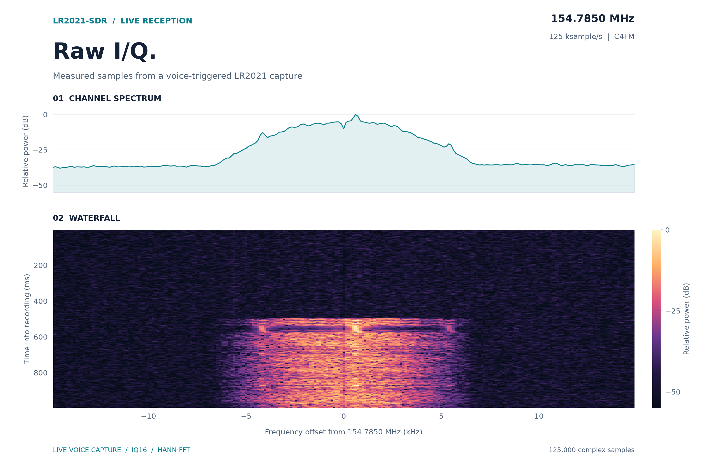
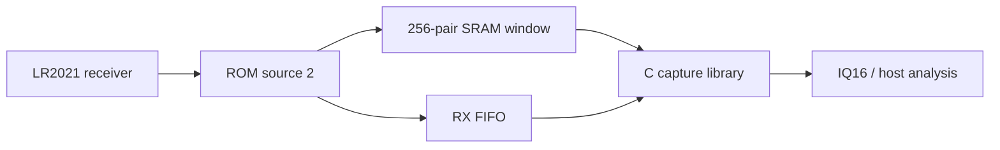

<h1 align="center">LR2021-SDR</h1>

<p align="center"><b>Raw I/Q reception. Experimental I/Q transmit playback.</b></p>

<p align="center">
  <a href="#start-here">Start here</a> |
  <a href="docs/porting.md">Porting</a> |
  <a href="docs/protocol.md">Protocol</a> |
  <a href="https://github.com/SAMS0N1TE/LakeShark">LakeShark</a>
</p>

Raw I/Q reception and experimental **amplitude-preserving I/Q transmit
playback** on the Semtech LR2021. This repository includes a portable C11
receive library, host tools, and a separate LakeShark TX integration with
upload tools and independently captured RF evidence.

**TX now carries decoded payloads using both amplitude and phase.** The final
tested build delivered **235 CRC-valid frames / 15,040 payload bits with zero
bit errors**, verified by an independent HackRF receiver.

| Capability | Verified result |
| --- | --- |
| Raw I/Q RX | LakeShark capture and processing ran for 391 seconds without reported FIFO loss or queue rejection |
| Live voice RX | P25 Phase 1 C4FM voice decoded from LR2021 raw I/Q in LakeShark |
| Amplitude + phase TX | Uploaded signed I8/Q8 drives a two-ring, four-phase 8-APSK payload waveform |
| TX sample rates | 4,800; 9,600; 19,200; 38,400; 76,800; 125,000 complex samples/s |
| Longest verified TX buffer | 31,648 complex samples / 63,296 FIFO bytes, carrying 92 consecutive valid frames at both 38.4 and 125 ksample/s |

> [!IMPORTANT]
> **Experimental; tested on LR2021 ROM 1.24.** The portable C library and
> standalone ESP32-P4 firmware provide RX. TX requires the separate
> [LakeShark integration](docs/tx-playback.md#integrating-the-source).
> TX is bounded playback; 125 ksample/s is an input rate, not a verified flat
> 125 kHz transmit bandwidth.

## Start here

**[Transmit I/Q](docs/tx-playback.md)** | **[ESP32-P4 RX firmware](firmware/esp32p4/README.md)** | **[Build the C tools](#build)** | **[Connect your driver](docs/porting.md)** | **[Console format](docs/console.md)**

For TX, install the [TX-enabled LakeShark integration](docs/tx-playback.md#integrating-the-source)
and follow the upload example below. The repository includes its source,
integration patch, waveform generator, uploader, decoder and RF recordings.

For a quick RX board test, use the [ESP32-P4 USB console firmware](firmware/esp32p4/README.md).
It includes a LilyGO T-Display-P4 adapter, checked FIFO tests and IQ16 capture
export. The screen and audio are unused. Other integrations can use the C API:

1. **Check the radio:** LR2021, ROM 1.24, with SPI, BUSY and reset access.
2. **Build the library and tools:** CMake and a C11 compiler; MinGW-w64 on Windows.
3. **Capture a window:** supply the board hooks, configure LoRa RX, then use the
   capture API or a compatible console. See [capture.c](examples/capture.c).

## I/Q transmit playback

The working TX path uses **OOK initialization followed by raw ROM command
`0x0293`, selector 0** to transmit signed I8/Q8. This setup passes both sample
magnitude and phase; GFSK initialization produces a constant envelope.
No PRAM patch is required.

The FIFO service reuses LakeShark's raw-RX fast SPI path. A 1 KiB TX FIFO,
owned 16 MHz SPI access, and checked refills sustain the tested finite
transmissions through 125 ksample/s. Uploads use acknowledged chunks and a
whole-buffer CRC-32 before playback is allowed.

### Send a payload

With the TX-enabled LakeShark firmware installed, run in the board console:

```text
tui off
mesh stop
lora config 915 7 62.5 5 -9
```

Install Python's `pyserial` package, then run from this repository:

```text
python tools/lr2021_make_apsk.py LAKESHAR frame.iq8
python tools/lr2021_tx_upload.py frame.iq8 --serial YOUR_USB_SERIAL --send 9600 --repeats 16
```

Replace `YOUR_USB_SERIAL` with the board's USB serial number, or use
`--port COM19` with the appropriate port. The first command generates an
8-APSK frame containing the eight-byte payload and CRC-16. The second uploads
and transmits it. Omit `--send` to upload only. The ready buffer can be sent
again without reflashing or resetting the board.

| Playback property | Current bound |
| --- | --- |
| RF configuration | Fixed 915 MHz, configured −9 dBm |
| Sample format | Interleaved signed 8-bit I, Q; no header |
| Upload size | 2–16,384 bytes, even length |
| Sample magnitude | `I*I + Q*Q <= 56*56` |
| Repetitions | 1–16 |
| Total samples per run | At most 32,767 complex samples, including repetitions |
| Sample duration | At most 900 ms per run |

Preserve relative sample amplitudes when scaling a waveform. Normalizing
each I/Q pair to a constant radius destroys the amplitude information. RX
IQ16 recordings require appropriate conversion and resampling before TX.

[Complete usage and integration](docs/tx-playback.md) ·
[Payload results, source, decoder and replayable RF evidence](research/tx-payload/)

### Waveform fidelity and remaining limits

The two amplitude rings in the decoded 8-APSK frames demonstrate useful
amplitude information at the receiver. Separate low-rate measurements found
5.6–7.7% settled-plateau EVM and 7.9–8.4% interior EVM on smooth signals
changing magnitude and phase every sample. These smooth signals used
150/300 Hz fundamentals and harmonics; they do not establish full-bandwidth
fidelity. Magnitudes above roughly 64 saturate, and small magnitudes have
larger phase errors. The demo uses four-step phase ramps to reduce distortion
at abrupt phase reversals.

For LakeShark, this adds a measured path for generating custom narrowband
waveforms and transmitting uploaded I/Q bursts alongside its existing raw-I/Q
receiver. **Calibrated linearity, indefinite host streaming, gapless burst
chaining and simultaneous RX/TX remain unverified.**

[Amplitude measurements](research/tx-amplitude/) ·
[Smooth waveform measurements](research/tx-smooth/) ·
[Phase-ramp measurements](research/tx-phase-ramp/) ·
[ROM command discovery and other modulation selectors](docs/tx-discovery.md)

## Capture and analysis



- 256-pair SRAM capture with verified memory restoration.
- Bounded FIFO capture, up to 250 ms at a nominal 125 ksample/s.
- IQ16 decoding, capture validation, tone measurement and sample-rate estimation.
- Windows serial burst capture and portable log conversion.
- Checked-session API, bounded queue and offline ROM tools.
- LakeShark live I/Q capture and decoder-input processing ran for 391 seconds
  without reported FIFO loss or queue rejection. See
  [live streaming results](docs/live-streaming.md) and
  [portable capture API](docs/continuous.md).



### Sustained live capture


Three separate live sessions ran for 227, 192 and 391 seconds with no reported
FIFO loss or queue rejection. LakeShark now captures and processes I/Q in
parallel, removing the former pauses between 250 ms windows. The graph shows
hardware measurements from the running receiver.
[Results and reproducible graph](docs/live-streaming.md).

### Live P25 reception

**Live P25 Phase 1 C4FM voice is confirmed through LakeShark's continuous
LR2021 raw-I/Q path at 154.7850 MHz.** The receiver was in I/Q mode, with 101 sync detections, 78 voice frames, zero reported capture gaps,
zero FIFO loss and zero audio drops at the observed snapshot.

| Observation | Result |
| --- | --- |
| Selected receiver | LR2021 raw I/Q |
| Sync detections | 101 |
| Voice frames | 78 |
| Reported capture gaps / FIFO loss | 0 / 0 |
| Read errors / audio drops | 0 / 0 |

[Call measurements and receiver details](docs/live-streaming.md#voice-observation).

### Captured voice


**These are the samples from a decoded voice call.** The live decoder triggered
an I/Q recorder at **154.7850 MHz** with a VHF antenna. The one-second recording
contains **125,000 complex samples**, passed export CRC verification, and
replayed through LakeShark's P25 decoder: **3 voice LDUs, 27 IMBE frames played,
zero muted frames**. The live receiver reported zero capture gaps and FIFO loss
at the post-capture snapshot.

The waterfall shows the call arriving halfway through the recording. Time and
frequency use the nominal 125 ksample/s rate; power is relative.
[Capture details and plotting data](docs/voice-capture.md).

### Known-tone checks


Real source-2 captures at 910.525 MHz, SF7, BW62.5 kHz. The left panel shows
80 I/Q pairs from a +25 kHz tone; the right compares separate 256-pair captures
at +25 and -15 kHz. Spectra use a Hann window, DC removal and separate peak
normalization. Amplitude is uncalibrated.

## Hardware

LR2021 with ROM firmware **1.24**, SPI, BUSY and reset access. Configure LoRa
RX before capture. An ESP32-P4 console target and LilyGO board adapter are
included under [firmware/esp32p4](firmware/esp32p4/README.md). For other hosts,
supply the board hooks described in [Porting](docs/porting.md).

| Capture | Output | Rate |
| --- | --- | --- |
| SRAM | 256 complex int16 pairs | Profile dependent |
| FIFO | 1..250 ms, with gaps between sessions | Nominal 125 ksample/s at BW31.25 kHz |
| Checked FIFO | 1..60000 ms per portable API session | Nominal 125 ksample/s at BW31.25 kHz |

LakeShark's live task integration runs until stopped; it is separate from the
portable API's duration limit.

Known-tone tests at 910.525 MHz, SF7 measured rates near 4 times LoRa bandwidth
for 31.25, 62.5, 125 and 250 kHz bandwidths. I occupies the low signed halfword,
Q the high halfword; positive RF offset produces positive frequency for I+jQ.
Other profiles need measurement. See [Protocol](docs/protocol.md).


Known-tone estimates follow 4 times the configured bandwidth within about
0.5% for the tested profiles. These are short-window rate measurements, not
a measure of continuous FIFO throughput.

## Build

Requires CMake 3.18+ and a C11 compiler. Windows builds use MinGW-w64.

```sh
cmake -S . -B build
cmake --build build
ctest --test-dir build --output-on-failure
cmake --install build --prefix install
```

Link `lr2021_iq` for radio capture and `lriq` for parsing and measurement.
Both libraries use caller-owned storage. See [capture.c](examples/capture.c).

## Tools

```sh
lriq_tool capture COM3 capture 10
lriq_tool analyze capture-0000.bin
lriq_tool unpack-fifo capture.log capture.iq16
```

`capture` requires Windows and firmware implementing `lora lrcap`. Select the
correct port; it opens at 115200 baud without resetting the board. Count 0
repeats until Ctrl+C. Bursts produce binary, CSV and metadata files.

`analyze` reads one 1024-byte SRAM window. `unpack-fifo` validates one compact
console transaction before saving interleaved little-endian IQ16. Existing
output files are preserved. [Console format](docs/console.md) describes the
firmware interface and signal-level trigger.

## Limitations

- Undocumented source routing, restricted to LR2021 ROM 1.24.
- Active PRAM patches and conflicting radio sessions are refused.
- Raw capture uses exclusive radio ownership and resets the radio during recovery.
- FIFO overflow and recovery failures are reported; rejected captures are invalid.
- P25 Phase 2 is not established. A P25 decoder is not included in this library.

## Take it handheld

<p align="center">
  <a href="https://github.com/SAMS0N1TE/LakeShark">
    <picture>
      <source media="(prefers-color-scheme: dark)" srcset="https://github.com/user-attachments/assets/657f79dc-afd4-4943-89b3-d9b215a7cb09">
      
    </picture>
  </a>
</p>

**LakeShark puts the radio workbench in your hand.** P25, aircraft tracking,
pagers, LoRa tools and offline maps on the LilyGO T-Display P4. Explore the
supported boards, see it running, and find the setup guides.

<p align="center">
  <a href="https://github.com/SAMS0N1TE/LakeShark"><b>Get LakeShark</b></a> |
  <a href="https://terminalbay.com/?m=lakeshark-showcase"><b>See it in action</b></a> |
  <a href="https://terminalbay.com/?m=wiki"><b>Setup guides</b></a>
</p>

## Standing on

| Project | Credit |
| --- | --- |
| [ESP-SDR](https://github.com/ESPARGOS/esp-sdr) | The ESPARGOS team's work exposing undocumented raw I/Q capture on ESP32 radios inspired this LR2021 investigation. Their project was the starting point for exploring a similar path on the LR2021. |
| [LakeShark](https://github.com/SAMS0N1TE/LakeShark) | Original LR2021 capture implementation and ESP32-P4 hardware integration. |

ESP-SDR is credited for the inspiration and published work; no ESP-SDR code is
included here. LR2021-SDR is [GPL-3.0](LICENSE).
