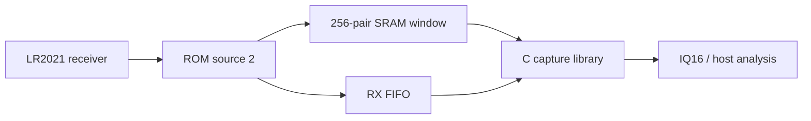

# LR2021-SDR

Experimental raw I/Q capture for the Semtech LR2021, written in C11.
Captures short receiver windows through an undocumented ROM path, with a
portable radio interface and native host tools.

## Features

- 256-pair SRAM capture with verified memory restoration.
- Bounded FIFO capture, up to 250 ms at a nominal 125 ksample/s.
- IQ16 decoding, capture validation, tone measurement and sample-rate estimation.
- Windows serial burst capture and portable log conversion.



## Hardware

LR2021 with ROM firmware **1.24**, SPI, BUSY and reset access. Configure LoRa
RX before capture. The original implementation was tested with an ESP32-P4
host; this standalone extraction has host tests only. Supply the board hooks
described in [Porting](docs/porting.md). No board firmware binary is provided.

| Capture | Output | Rate |
| --- | --- | --- |
| SRAM | 256 complex int16 pairs | Profile dependent |
| FIFO | 1..250 ms, with gaps between sessions | Nominal 125 ksample/s at BW31.25 kHz |

Known-tone tests at 910.525 MHz, SF7 measured rates near 4 times LoRa bandwidth
for 31.25, 62.5, 125 and 250 kHz bandwidths. I occupies the low signed halfword,
Q the high halfword; positive RF offset produces positive frequency for I+jQ.
Other profiles need measurement. See [Protocol](docs/protocol.md).

## Build

Requires CMake 3.18+ and a C11 compiler. Windows builds use MinGW-w64.

```sh
cmake -S . -B build
cmake --build build
ctest --test-dir build --output-on-failure
cmake --install build --prefix install
```

Link `lr2021_iq` for radio capture and `lriq` for parsing and measurement.
Both libraries use caller-owned storage. See [capture.c](examples/capture.c).

## Tools

```sh
lriq_tool capture COM3 capture 10
lriq_tool analyze capture-0000.bin
lriq_tool unpack-fifo capture.log capture.iq16
```

`capture` requires Windows and firmware implementing `lora lrcap`. Select the
correct port; it opens at 115200 baud without resetting the board. Count 0
repeats until Ctrl+C. Bursts produce binary, CSV and metadata files.

`analyze` reads one 1024-byte SRAM window. `unpack-fifo` validates one compact
console transaction before saving interleaved little-endian IQ16. Existing
output files are preserved. [Console format](docs/console.md) describes the
firmware interface and signal-level trigger.

## Limitations

- Undocumented source routing, restricted to LR2021 ROM 1.24.
- Active PRAM patches and conflicting radio sessions are refused.
- Capture interrupts normal reception and resets the radio during recovery.
- FIFO windows can overflow, including with internal RAM. Any capture or
  recovery error invalidates the output; continuous lossless reception is unproven.
- P25 Phase 1 C4FM and CQPSK control frames decoded from qualified synthetic RF
  captures in the original integration. Live P25, audio quality and Phase 2
  are not established. A P25 decoder is not included.

## Credits and license

Developed from the LR2021 capture work in
[LakeShark](https://github.com/SAMS0N1TE/LakeShark).
[ESP-SDR](https://github.com/ESPARGOS/esp-sdr) inspired the raw-radio investigation.
No ESP-SDR code is included. GPL-3.0; see [LICENSE](LICENSE).
