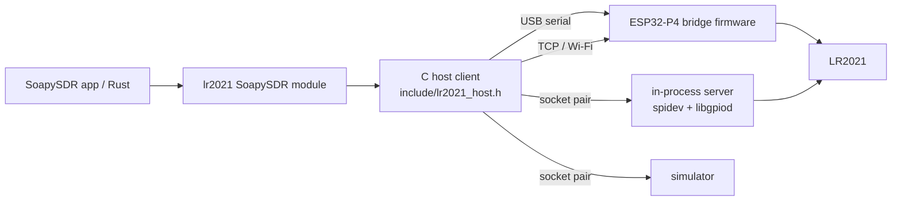

# Use the LR2021 as an SDR on a computer

[Guides](README.md) / Host SDR

The host side turns an LR2021 into an ordinary SDR for SoapySDR applications
(GQRX, CubicSDR, GNU Radio through gr-soapy, SoapySDRUtil, Python bindings)
and for Rust programs. Everything below is built on this repository's library
and measurements: 16-bit source-2 receive and the `0x0293` transmit path.



Every backend speaks the [bridge protocol](bridge-protocol.md). The device
side of that protocol is one portable C file
([`src/lr2021_bridge_server.c`](../src/lr2021_bridge_server.c)) used by the
firmware, the local Linux backend and the simulator alike.

## Install

Linux (Debian, Ubuntu, Raspberry Pi OS) and macOS. Windows builds the C
library, simulator and tests, but not the host client or module.

```bash
sudo apt-get install cmake g++ libsoapysdr-dev soapysdr-tools libgpiod-dev
```

```bash
cmake -S . -B build -DCMAKE_BUILD_TYPE=Release
```

```bash
cmake --build build --parallel && ctest --test-dir build --output-on-failure
```

```bash
sudo cmake --install build
```

On Fedora use `dnf install cmake gcc-c++ SoapySDR-devel libgpiod-devel`; on
macOS `brew install cmake soapysdr`. The module installs as
`lib/SoapySDR/modules<ABI>/liblr2021Support.so`. To try it from the build tree
instead, set `SOAPY_SDR_PLUGIN_PATH=build/soapy`. CMake options:
`-DLR2021_WITH_SOAPY=OFF` skips the module, `-DLR2021_WITH_GPIOD=OFF` the local
backend. libgpiod 1.6 and 2.x are both supported and detected at build time.

For USB serial and local SPI/GPIO access without root, install the
[udev rules](../udev/60-lr2021-sdr.rules) as described in the file. The rules
also stop ModemManager from probing the bridge port.

## Find and open a device

```bash
SoapySDRUtil --find="driver=lr2021"
```

```bash
SoapySDRUtil --probe="driver=lr2021,serial=/dev/ttyACM0,baud=4000000,format=cs12"
```

Without a target, `--find` lists USB serial ports whose IDs match the CH343
(`1a86:55d3`) or ESP32 USB (`303a:1001`, `303a:4001`) without opening them,
because opening a port can reset the board. Add `probe=1` to a target to open
it and confirm it answers.

| Argument | Backend | Meaning |
| --- | --- | --- |
| `serial=/dev/ttyACM0` | serial | bridge firmware on a USB serial port |
| `baud=4000000` | serial | bridge rate; default 3000000 |
| `boot_ms=1200` | serial | wait after opening, for a board that resets on open |
| `host=192.168.4.1` | TCP | bridge firmware on Wi-Fi, or `lr2021_bridge_sim` |
| `port=51021` | TCP | default 51021 |
| `format=cs12` | serial, TCP | packed 12-bit transport for slow links; default `cs16` |
| `spidev=/dev/spidev0.0` | local | the chip on this host's SPI bus |
| `gpiochip=gpiochip0`, `reset=N`, `busy=N` | local | GPIO lines for NRESET (output) and BUSY (input) |
| `spi_hz=16000000` | local | SPI clock |
| `tcxo=3.3`, `tcxo_ticks=32768` | local | TCXO voltage (`off`, 1.6 ... 3.3) and start-up delay |
| `rfsw=8:2,10:0` | local | RF switch table, `dio:modes[:pull]`; modes bits standby, RX LF, TX LF, RX HF, TX HF |
| `sim=tone` or `sim=counter` | simulator | in-process LR2021 model, no hardware |
| `tone=154810000` | simulator | RF of the simulated tone |
| `tx_unchecked=true` | any | see [Transmit](#transmit) |

A simulator over TCP, for testing applications or other clients:

```bash
build/lr2021_bridge_sim --port 51021 --pattern tone --tone 433950000
```

## Receive

| Property | Value | Source |
| --- | --- | --- |
| Frequency | 100 MHz to 2740 MHz; antenna `AUTO` picks LF below 1.5 GHz, HF above; `LF`/`HF` force a path | [receive range](../research/rx-range-and-gain/README.md) |
| Sample rate | 125000 (LoRa BW 31.25 kHz) or 250000 (BW 62.5 kHz) complex samples/s | [protocol](protocol.md) |
| Format | CS16 native (I low halfword, positive frequency above the tuned frequency), CF32 | |
| Gain | `STEP` 1..13, `BOOST` 0..7 (acts at steps 12 and 13); overall gain 1..20 = step, then boost; AGC mode = chip AGC (step 0) | [gain table](../research/rx-range-and-gain/README.md#gain-and-boost) |
| Timestamps | every `readStream` has `SOAPY_SDR_HAS_TIME`: device time of the stream's first sample plus index / nominal rate | |

The measurements say step 12 or 13 is best for weak signals and that the chip
AGC is about 20 dB worse than a fixed step on strong ones; the default is step
13 without boost. Gain changes while streaming do not interrupt the samples.

At 100 to 104 MHz the radio still flags IMG_CAL although reception works; the
module logs the error bits and continues. 250000 samples/s was clean in 40 ms
captures; long sessions at that rate are not established on the original
board adapter.

Retuning or changing the rate while streaming restarts the stream: the next
`readStream` returns `SOAPY_SDR_OVERFLOW`, then data from the new setting.
Overflow is also returned whenever the device or the host had to drop
samples, so a gap is never hidden. If the radio session fails (for example on
FIFO overflow on a slow local SPI host), the module restarts it and reports
an overflow.

Timestamps are nominal: the source-2 rate measured within about 0.5% of
4 x bandwidth, and the time of sample 0 is taken when the stream's first
retained FIFO data is read, not latched by the radio. They are consistent
within a stream; do not expect sub-microsecond alignment with other devices.

### Link budget

| Link | 125000/s | 250000/s |
| --- | --- | --- |
| CS16 (511 / 1023 kB/s) | TCP, USB Serial/JTAG | TCP |
| CS12 (386 / 773 kB/s) | CH343 UART at 4 Mbaud | TCP |

The CH343 on the LilyGO board carries 400 kB/s at 4 Mbaud and did not link at
5 Mbaud, so use `format=cs12` on that port. CS12 is exact while a 480-sample
frame stays within ±2047 counts; stronger frames lose their low bits (the
shift is reported per frame), and nothing is clipped.

## Transmit

Half duplex. `writeStream` collects samples until a call carries
`SOAPY_SDR_END_BURST`, then sends the whole burst; receive is stopped for the
burst and resumed afterwards. `readStreamStatus` reports `SOAPY_SDR_END_BURST`,
or the error. `SOAPY_SDR_HAS_TIME` on the first call schedules the burst at
that hardware time; the device starts it from a polling loop, so expect about
a millisecond of jitter.

| Property | Default (tested contract) | `tx_unchecked=true` (hardware limits only) |
| --- | --- | --- |
| Samples per burst | 32767, including the `repeats` stream argument | same: the ROM stores a 16-bit byte count |
| Burst length | 900 ms | below the 512 s SetTx timeout |
| Rates | 4800, 9600, 19200, 38400, 76800, 125000 | 1 to 1000000 |
| Frequency | 150 to 960 MHz, LF PA | 100 to 2740 MHz, LF or HF PA (`AUTO` antenna: HF from 1.5 GHz) |
| Power (`PA` gain) | -9.5 to +10 dBm configured; -9 dBm is what was measured | LF -9.5 to +22, HF -19.5 to +12 dBm |
| Sample magnitude | I² + Q² <= 56² | int8 range |
| Repeats | 1..16 | 1..255 |

Formats: CS8 is native (passed through unchanged), CS16 and CF32 are scaled so
that full scale (32768, or magnitude 1.0) is radius 56, the largest tested
radius; larger samples are limited to radius 56 with their phase kept, and the
module logs how many. Scale the whole waveform, not each sample: the path
carries amplitude as well as phase ([TX playback](tx-playback.md)).

In unchecked mode the device reports what left the tested contract in
`TX_END.untested`, and the module logs it. Unchecked bursts are research
territory: the PA settings for powers other than -9 dBm and for the HF PA come
from the datasheet tables, not from measurements on a board. Check the board's
RF switch table has the TX bits it needs (the LilyGO default table sets only
the RX LF line) and follow your local regulations.

## Local Linux backend

The chip on the host's own SPI bus, for example a Raspberry Pi. Wire SCLK,
MOSI, MISO and NSS to an SPI controller (NSS is the spidev chip select), BUSY
to an input GPIO and NRESET to an output GPIO. Enable SPI
(`dtparam=spi=on`), install the udev rules, then:

```bash
SoapySDRUtil --probe="driver=lr2021,spidev=/dev/spidev0.0,gpiochip=gpiochip0,reset=25,busy=24,tcxo=3.3,rfsw=8:2"
```

The in-process server runs the radio loop in its own thread and asks for
`SCHED_FIFO` (granted to root or with `CAP_SYS_NICE`); without it, other load
can delay the FIFO service past its deadline (2 ms with the 1 KiB FIFO at
125000 samples/s), which ends the session with an overflow that the module
reports. Each SPI transfer is a separate `ioctl`, so a fast host is needed for
250000 samples/s.

## Rust

[`rust/`](../rust/README.md) has three crates: `lr2021-sys` (bindings to this C
library), `lr2021` (safe API: simulator, device sessions, TX checks and the C
host client) and `lr2021-bridge` (the bridge protocol in pure Rust, with a
blocking client, cross-tested against the C code).

## What is tested where

Hardware results come from a LilyGO T-Display-P4 LR2021 board; the
repository's automated tests use the simulator.

| Part | Simulator / CI | On hardware |
| --- | --- | --- |
| Library: configure, sessions, live gain, TX burst | yes (`device_session_tx`) | receive paths as in the existing research; the TX sequence written for this library is not yet on air |
| Bridge protocol, server, CS12 | yes (`bridge_protocol`, Rust cross tests) | serial CS12 at 4 Mbaud, 60 s at 125000/s: no device drops, about 0.2% frames lost to CRC errors (LilyGO T-Display-P4 LR2021, 2026-10-27); CS16 at 4 Mbaud drops about 21%, all reported |
| Host client: serial (pty), TCP, in-process | yes (`host_client`) | not yet run against the board |
| SoapySDR module | yes (`soapy_module`, SoapySDRUtil in CI) | not yet run against the board |
| Local spidev/libgpiod backend | builds (libgpiod 1.6 in CI) | not tested; libgpiod 2.x path compiles only where 2.x is installed |
| macOS | CI builds and runs the tests | no hardware |
| Timed TX, unchecked TX, HF PA | simulator only | not tested |
