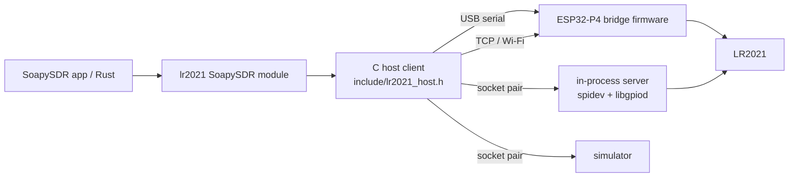

# Use the LR2021 as an SDR on a computer

[Guides](README.md) / Host SDR

The host side turns an LR2021 into an ordinary SDR for SoapySDR applications
(GQRX, CubicSDR, GNU Radio through gr-soapy, SoapySDRUtil, Python bindings)
and for Rust programs. It covers 16-bit source-2 receive from 125000 to
1000000 samples/s, IQ8 and gain-tagged receive from the chip's other raw
sources at an explicit output rate, and transmit through the `0x0293` path.



Every backend speaks the [bridge protocol](bridge-protocol.md). The device
side of that protocol is one portable C file
([`src/lr2021_bridge_server.c`](../src/lr2021_bridge_server.c)) used by the
firmware, the local Linux backend and the simulator alike.

## Install

Linux (Debian, Ubuntu, Fedora, Raspberry Pi OS) and macOS. Windows (MinGW-w64)
builds the host client with its serial (`serial=COM5`), TCP and simulator
backends, the bridge simulator tool and the [rtl_tcp server](rtl-tcp.md),
but not the SoapySDR module or the local spidev backend.

```bash
sudo apt-get install cmake g++ libsoapysdr-dev soapysdr-tools libgpiod-dev
```

```bash
cmake -S . -B build -DCMAKE_BUILD_TYPE=Release
```

```bash
cmake --build build --parallel && ctest --test-dir build --output-on-failure
```

```bash
sudo cmake --install build
```

On Fedora use `dnf install cmake gcc-c++ SoapySDR-devel libgpiod-devel`; on
macOS `brew install cmake soapysdr`. The module installs as
`lib/SoapySDR/modules<ABI>/liblr2021Support.so`. To run it from the build tree,
set `SOAPY_SDR_PLUGIN_PATH=build/soapy`. CMake options:
`-DLR2021_WITH_SOAPY=OFF` skips the module, `-DLR2021_WITH_GPIOD=OFF` the local
backend. libgpiod 1.6 and 2.x are both supported and detected at build time.

For USB serial and local SPI/GPIO access without root, install the
[udev rules](../udev/60-lr2021-sdr.rules) as described in the file. The rules
also keep ModemManager away from the bridge port.

## Find and open a device

```bash
SoapySDRUtil --find="driver=lr2021"
```

```bash
SoapySDRUtil --probe="driver=lr2021,host=192.168.4.1"
```

```bash
SoapySDRUtil --probe="driver=lr2021,serial=/dev/ttyACM0,baud=4000000,format=cs12"
```

`--find` lists USB serial ports whose IDs match the CH343 (`1a86:55d3`) or
ESP32 USB (`303a:1001`, `303a:4001`) by their USB IDs alone, so a board is not
reset by being listed. Add `probe=1` to a target to open it and confirm it
answers.

| Argument | Backend | Meaning |
| --- | --- | --- |
| `serial=/dev/ttyACM0` | serial | bridge firmware on a USB serial port |
| `baud=4000000` | serial | bridge rate; default 3000000 |
| `boot_ms=1200` | serial | wait after opening, for a board that resets on open |
| `host=192.168.4.1` | TCP | bridge firmware on Wi-Fi, or `lr2021_bridge_sim` |
| `port=51021` | TCP | default 51021 |
| `format=cs12` | serial, TCP | 12-bit packing of source-2 samples; default `cs16` |
| `route=source0` | any | receive route: `source2` (default), `source0`, `source1`, `source6` |
| `input_code=17` | any | FSK RX filter code used with the raw routes; default 17 |
| `spidev=/dev/spidev0.0` | local | the chip on this host's SPI bus |
| `gpiochip=gpiochip0`, `reset=N`, `busy=N` | local | GPIO lines for NRESET (output) and BUSY (input) |
| `spi_hz=16000000` | local | SPI clock |
| `tcxo=3.3`, `tcxo_ticks=32768` | local | TCXO voltage (`off`, 1.6 ... 3.3) and start-up delay |
| `rfsw=8:6,10:0` | local | RF switch table, `dio:modes[:pull]`; modes bits standby, RX LF, TX LF, RX HF, TX HF |
| `sim=tone` or `sim=counter` | simulator | in-process LR2021 model |
| `tone=154810000` | simulator | RF of the simulated tone |
| `tx_checked=true` | any | refuse TX bursts outside the measured contract, see [Transmit](#transmit) |
| `tx_simo=true` | any | run TX bursts with the SIMO DC-DC supplying the PA |

`route`, `input_code`, `tx_checked` and `tx_simo` are also SoapySDR settings
(`writeSetting`) that can change while the device is open.

A simulator over TCP, for applications and other clients:

```bash
build/lr2021_bridge_sim --port 51021 --pattern tone --tone 433950000
```

## Receive

| Property | Value | Source |
| --- | --- | --- |
| Frequency | 100 MHz to 2740 MHz; antenna `AUTO` picks LF below 1.5 GHz, HF above; `LF`/`HF` select a path | [receive range](../research/rx-range-and-gain/README.md) |
| Source 2 rates | 125000, 250000, 500000 and 1000000 complex samples/s: 4 x LoRa BW 31.25, 62.5, 125 and 250 kHz | [protocol](protocol.md) |
| Raw-route rates | any output rate from 1000 to 4000000 samples/s | [raw routes](#raw-receive-routes) |
| Format | CS16 native (I low halfword, positive frequency above the tuned frequency), CF32 | |
| Gain | `STEP` 1..13, `BOOST` 0..7 (acts at steps 12 and 13); overall gain 1..20 = step, then boost; AGC mode = chip AGC (step 0) | [gain table](../research/rx-range-and-gain/README.md#gain-and-boost) |
| Timestamps | every `readStream` has `SOAPY_SDR_HAS_TIME`: device time of the stream's first sample plus index / nominal rate | |

Step 12 or 13 gives the best weak-signal results in the gain measurements,
and a fixed step beats the chip AGC by about 20 dB on strong signals; the
default is step 13 without boost. `STEP` changes apply live, with no gap in the
samples. `BOOST` changes go through SetRxPath, which ROM 1.24 takes in
standby, so the module restarts the stream around them (one
`SOAPY_SDR_OVERFLOW`).

Reception works down to 100 MHz; from 100 to 104 MHz the radio also sets the
IMG_CAL error bit, which the module logs. Retuning or changing the rate while
streaming restarts the stream: the next `readStream` returns
`SOAPY_SDR_OVERFLOW`, then data from the new setting. Overflow is also returned
whenever the device or the host dropped samples, so every gap is visible. If
the radio session ends (for example on FIFO overflow), the module restarts it
and reports an overflow.

Timestamps follow the nominal rate, which the known-tone measurements put
within about 0.5% of 4 x bandwidth for source 2, counted from the first
retained FIFO data of the stream. They are exact from sample to sample within a
stream.

Source 2 carries 4 bytes per pair, so the radio's FIFO has to be drained at
0.5, 1, 2 and 4 MB/s for the four rates. On the LilyGO board the bridge
firmware drives the SPI registers directly at 26.67 MHz: a two-frame FIFO
level query takes 32 us and a 256-byte read 110 us. Over Wi-Fi, 30-second
runs delivered every pair with FIFO peaks of 68 bytes at 125000, 220 bytes at
250000 and 266 bytes for source 0 at 576000 pairs/s. With 1020-byte reads,
source 2 at 500000 samples/s carried 1.93 MB/s with every pair delivered for
1.39 s per session.

Each session can raise its FIFO read size to 1020 bytes and check the FIFO
flags once per 4 KiB instead of once per 1 KiB (`lr2021_iq_session.max_read`,
`check_bytes`, `buffer`; `lr2021_bridge_server_tune` on the device). The local
spidev backend and the simulator use 1020 and 4096.

### Raw receive routes

The `0x0290` route command selects one of the chip's internal sources. The
library builds it as: byte 0 the FSK RX filter code (`input_code`), bytes 1..4
the output rate (big endian), byte 5 `0x08 | source` for FIFO output, and a
final FIFO-enable byte. Source 2 uses `FF 00 00 00 00 0A 00 00 00 00 01` with
its native LoRa rate. The raw routes run under an FSK setup (10 kbit/s, 5 kHz
deviation, RX filter code `input_code`):

| Route | Source | Bytes per pair | Stream format |
| --- | --- | --- | --- |
| `source0` | 0 | 2 | IQ8: int8 I, Q |
| `source1` | 1 | 2 | IQ8: int8 I, Q, at the source's own rate (about 740000 pairs/s; the route's rate field does not change it) |
| `source6` | 6 | 2 | IQ6G: signed 6-bit I and Q in bits 7..2 of each byte, gain step in the low bits |

The module scales IQ8 by 256 and IQ6 by 1024 into CS16 (CF32 full scale is
the same). The bridge carries these bytes unchanged, up to 960 pairs per
frame, so 576000 pairs/s is about 1.2 MB/s on the link.

Results on the LilyGO T-Display-P4 board (ROM 1.24), streamed through the
bridge firmware over Wi-Fi TCP with SPI at 26.67 MHz:

| Route | Setting | Result |
| --- | --- | --- |
| Source 0 | input code 17, 576000 pairs/s, route `11 00 08 CA 00 08 00 00 00 00 01` | 60 s: 34561720 pairs, every pair delivered, device rate 575984 pairs/s, FIFO peak 538 bytes, largest service gap 476 us, flags `0x04`. Through SoapySDR, 60 s of `readStream` gave 34562880 samples with no overflow and timestamp steps exact to 1 ns |
| Source 0 | rate and orientation | a fixed RF line from the board moved 49.99 kHz for a 50.000 kHz retune (rate within 0.02% of 576000), positive frequency is RF above the tuned frequency, and the line passes at +203.66 kHz, 20.1 dB over its surroundings |
| Source 6 | input code 28 (`0x1C`), 50000 pairs/s, route `1C 00 00 C3 50 0E 00 00 00 00 01` | 49897 pairs/s; every pair tagged with the manual gain step (249884 pairs at step 9, 250076 at step 4) |

In earlier bounded lab captures on the same board, source 0 at 576000 pairs/s
with input code 17 kept a +200 kHz tone within 0.91 dB of the +50 kHz level,
against 16.4 dB below with input code 33.

The bridge server streams these routes through the same checked FIFO session
as source 2.

### Link budget

| Link | Carries |
| --- | --- |
| CH343 UART at 4 Mbaud (400 kB/s) | source 2 at 125000/s as CS12 (386 kB/s) |
| TCP over the board's Wi-Fi | source 2 at 250000/s as CS16 (1023 kB/s): 10 minutes with every pair delivered |
| TCP, two-byte routes | source 0 at 576000 pairs/s (1.2 MB/s): 60 s with every pair delivered |

CS12 packs source-2 samples as block floating point: exact while a frame stays
within ±2047 counts, and stronger frames keep their top 12 bits with the shift
reported per frame.

## Transmit

Half duplex. `writeStream` collects samples until a call carries
`SOAPY_SDR_END_BURST`, then sends the whole burst; receive pauses for the burst
and resumes afterwards. `readStreamStatus` reports `SOAPY_SDR_END_BURST`, or the
error. `SOAPY_SDR_HAS_TIME` on the first call schedules the burst at that
hardware time; the device starts it from a polling loop, within about a
millisecond.

| Property | Range | Measured on the LilyGO board |
| --- | --- | --- |
| Samples per burst | up to 32767 including the `repeats` stream argument (the ROM keeps a 16-bit byte count) | 32767 at 915 MHz, 125000/s |
| Burst length | up to the 512 s SetTx timeout | 0.82 s (31648 samples at 38400/s) |
| Rates | 1 to 1000000 samples/s | 4800, 9600, 19200, 38400, 76800, 125000, 250000 (16000 samples at 915 MHz, received for 64.0 ms by an RTL-SDR) |
| Frequency | 100 to 2740 MHz, LF or HF PA (`AUTO` antenna: HF from 1.5 GHz) | 433.92 and 915 MHz, LF PA |
| Power (`PA` gain) | LF -9.5 to +22 dBm, HF -19.5 to +12 dBm (datasheet SetTxParams ranges) | -9 dBm |
| Sample magnitude | int8 | amplitude follows the input up to radius 56; saturation from about radius 64 |
| Repeats | 1..255 | 1..16 |

Every burst reports in `TX_END.untested` which of its settings lie outside the
measured column, and the module logs it. `tx_checked=true` makes the device
refuse such bursts instead. The PA configuration for powers other than -9 dBm
and for the HF PA follows the datasheet tables.

Formats: CS8 is native and passed through unchanged; CS16 and CF32 are scaled
so that full scale (32768, or magnitude 1.0) is radius 56, and larger samples
are limited to radius 56 with their phase kept. Scale the whole waveform rather
than each sample: the path carries amplitude as well as phase
([TX playback](tx-playback.md)).

Before transmitting, set the board's RF switch table for TX (the LilyGO
profile drives DIO8 for TX LF), and follow your local regulations.

## Local Linux backend

The chip on the host's own SPI bus, for example a Raspberry Pi. Wire SCLK,
MOSI, MISO and NSS to an SPI controller (NSS is the spidev chip select), BUSY
to an input GPIO and NRESET to an output GPIO. Enable SPI
(`dtparam=spi=on`), install the udev rules, then:

```bash
SoapySDRUtil --probe="driver=lr2021,spidev=/dev/spidev0.0,gpiochip=gpiochip0,reset=25,busy=24,tcxo=3.3,rfsw=8:6"
```

The in-process server runs the radio loop in its own thread with `SCHED_FIFO`
when the process has `CAP_SYS_NICE` (or runs as root), which keeps the FIFO
serviced within its 2 ms window at 125000 samples/s.

## rtl_tcp clients

[`lr2021_tcp`](rtl-tcp.md) serves the board to rtl_tcp clients (SDR++, SDR#,
gqrx, OpenWebRX, GNU Radio) on Windows, Linux and macOS without SoapySDR. It
takes the same device arguments:

```bash
lr2021_tcp -d serial=COM5,baud=4000000,format=cs12
```

Set the client to 250000 samples/s; the [rtl_tcp page](rtl-tcp.md) has the
command, gain and sample-format mapping.

## Rust

[`rust/`](../rust/README.md) has three crates: `lr2021-sys` (bindings to this C
library), `lr2021` (safe API: simulator, device sessions, TX checks and the C
host client) and `lr2021-bridge` (the bridge protocol in pure Rust, with a
blocking client, cross-tested against the C code).

## Measurements and tests

Hardware results come from a LilyGO T-Display-P4 LR2021 board (ROM 1.24),
2026-10-27. The automated tests run every part below against the chip
simulator on Linux and macOS; the C library, host client and rtl_tcp tests also
run on Windows.

| Part | Automated tests | Measured on the board |
| --- | --- | --- |
| Library: configure, sessions, live gain, TX burst | `device_session_tx` | TX bursts at 915 and 433.92 MHz, 19200 and 125000 S/s, up to 32767 samples, end with TX_DONE; a HackRF received the 433.92 MHz burst at the expected offset and length. TX FIFO writes carry up to 62 bytes per SPI frame |
| Bridge protocol, server, CS12 | `bridge_protocol`, Rust cross tests | USB serial at 4 Mbaud, CS12, 60 s at 125000/s: every pair delivered by the radio side, 99.8% received by the host |
| SoapySDR module over TCP | `soapy_module`, SoapySDRUtil in CI | RX 60 s at 125000 and 250000 S/s with exact timestamp steps; 10 minutes at 250000 S/s with every pair delivered; live STEP changes without a gap; one overflow per retune. TX: a CF32 writeStream burst of 16000 samples at 125000 S/s lasted 129 ms on a HackRF (128 nominal); a HAS_TIME burst 2 s ahead started 11 us after the requested time; receive at 250000 S/s resumed 0.4 s after a burst with one overflow |
| Host client: serial (pty), TCP, in-process | `host_client` | TCP over Wi-Fi |
| Raw routes | `device_session_tx`, `bridge_protocol`, `soapy_module`, Rust cross tests | source 0 at 576000 pairs/s for 60 s over Wi-Fi and through SoapySDR, every pair delivered; source 6 gain tags match the manual step |
| Source 2 at 500000 S/s | same | 1.93 MB/s with every pair delivered for 1.39 s per session, with 1020-byte reads |
| Local spidev/libgpiod backend | builds with libgpiod 1.6 in CI | |
| HF PA, `tx_simo` | `device_session_tx` | |
| Windows host client (TCP, simulator) | `host_client` | COM ports build but are not tested |
| rtl_tcp server | `rtl_tcp_server`, `rtl_tcp_client` | no rtl_tcp client program run against the board yet |
