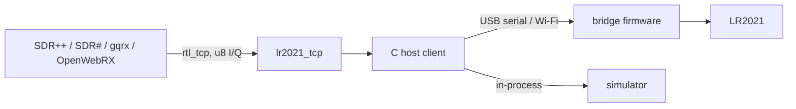

# rtl_tcp server

[Guides](README.md) / [Host SDR](host-sdr.md) / rtl_tcp server

`lr2021_tcp` makes the LR2021 look like an `rtl_tcp` server, so any program
that can read from `rtl_tcp` can receive with it: SDR++, SDR#, gqrx, OpenWebRX
and GNU Radio's osmosdr source, on Windows, Linux or macOS, without SoapySDR.
It runs on top of the [host client](host-sdr.md), so the board can be on USB
serial, on Wi-Fi through the bridge firmware, on a Linux host's own SPI bus,
or replaced by the simulator. Receive only.



The chip's 16-bit samples travel to the computer as the host client
receives them; the server converts them to the unsigned 8-bit pairs rtl_tcp
clients expect.

## Build

The same CMake build as the [host client](host-sdr.md#install). On Windows
use MinGW-w64 (the `MinGW Makefiles` generator, as in CI); the program only
needs system DLLs. CI also publishes `lr2021_tcp.exe` as the
`lr2021-windows-tools` artifact of each Windows build.

```bash
cmake -S . -B build -DCMAKE_BUILD_TYPE=Release
```

```bash
cmake --build build --parallel
```

Without SoapySDR installed, CMake simply skips the module; the server does not
need it.

## Run

Give the device as `key=value` pairs, the same keys the SoapySDR module and
the host client take ([argument table](host-sdr.md#find-and-open-a-device)):

```bash
lr2021_tcp -d serial=COM5,baud=4000000,format=cs12
```

```bash
lr2021_tcp -d serial=/dev/ttyACM0,baud=4000000,format=cs12
```

```bash
lr2021_tcp -d host=192.168.4.1
```

```bash
lr2021_tcp -d sim=tone,tone=433930000 -f 433.92M
```

| Option | Meaning |
| --- | --- |
| `-d`, `--device` | device arguments; `rfsw=8:2,10:0` stays one value |
| `-a`, `--address` | listen address, default `127.0.0.1`; `0.0.0.0` for every interface |
| `-p`, `--port` | listen port, default 1234 |
| `-f`, `--freq` | initial frequency, `k`/`M`/`G` suffixes, default 433.92M |
| `-s`, `--rate` | initial rate, snapped as below, default 250000 |
| `-g`, `--gain` | initial gain: `auto` (chip AGC) or level 1..20, default 13 |
| `-P`, `--ppm` | frequency correction until a client sends one |
| `--antenna` | `auto` (LF below 1.5 GHz, HF above), `lf` or `hf` |
| `--shift`, `--scale` | 16-bit to 8-bit conversion, see [Sample format](#sample-format) |
| `-q`, `--quiet` | log only errors, lost samples and clipping |

The CH343 port on the LilyGO board needs `format=cs12` at 4 Mbaud; see the
[link budget](host-sdr.md#link-budget). rtl_tcp has no authentication: listen
on `0.0.0.0` only on a network you trust.

One client is served at a time; a second connection is accepted and closed
straight away, with a log line. When a client disconnects the stream stops,
and the next client is served without restarting the program. Settings
persist from one client to the next. If the device link fails, the server
logs it and reopens the device for the next client. Ctrl+C stops it.

## Clients

Set the client's sample rate to **250000** (or 125000). rtl_tcp has no way to
tell a client the real rate, so a client left at 2.4 MS/s draws the spectrum
and plays audio at the wrong scale. The server logs every rate request it had
to change:

```
lr2021_tcp: sample rate 2048000 requested; the LR2021 streams 250000 samples/s, set the client to 250000
```

**SDR++.** Source `RTL-TCP`, IP `127.0.0.1` (or the server's address), port
`1234`, sample rate `250000`. Leave direct sampling, offset tuning and bias-T
off. The gain slider steps through the 29 R820T values in the table below;
`Tuner AGC` or `RTL AGC` selects the chip AGC.

**gqrx.** In *Configure I/O devices* choose *Other* and enter the device
string `rtl_tcp=127.0.0.1:1234`, input rate `250000`. Hardware AGC selects the
chip AGC; otherwise the gain value (in dB on the R820T scale) picks the
nearest row of the table.

**GNU Radio, OpenWebRX and others** that use gr-osmosdr take the same
`rtl_tcp=host:port` string with a 250000 sample rate. SDR#'s RTL-SDR TCP
source connects the same way; pick 0.25 MSPS if its rate list offers it.

These client settings follow each program's rtl_tcp support; none of the
clients has been run against this server yet (see [Tested](#what-is-tested)).

## Commands

The server sends the usual 12-byte header (`RTL0`, tuner type 5 = R820T, 29
gain values) and takes 5-byte commands: one command byte, then a 32-bit
big-endian value.

| Command | Value | What the LR2021 does |
| --- | --- | --- |
| `0x01` frequency | Hz | retunes (stop, configure, start); anything the library accepts, 100 MHz to 2.74 GHz. A rejected frequency is logged and the previous one kept |
| `0x02` sample rate | samples/s | snapped: below 187500 → 125000, otherwise 250000 (125000 only if the device lacks the 250k capability); logged when changed |
| `0x03` gain mode | 0 auto, 1 manual | auto selects the chip AGC (gain step 0); manual restores the last manual level |
| `0x04` gain | tenths of a dB | nearest R820T table value, then that row's level |
| `0x05` frequency correction | ppm, signed | tunes to f / (1 + ppm·10⁻⁶): positive when the board's reference runs fast. ±1000 ppm |
| `0x08` RTL AGC | 0 / 1 | on also selects the chip AGC (there is no separate digital AGC) |
| `0x0d` gain by index | 0..28 | that row of the table |
| `0x06` IF gain, `0x0b`/`0x0c` crystal | | not applicable; logged once per client and ignored |
| `0x07` test mode, `0x09` direct sampling, `0x0a` offset tuning, `0x0e` bias-T | | off is accepted silently; on is logged once and ignored |

Commands that arrive together are applied together: one retune for a burst of
settings, and a gain change on its own is applied live without interrupting
the stream. A change that moves the boost (levels 14 to 20) restarts the
stream, because the chip only takes a new boost between sessions.

## Gain

The LR2021 has 13 gain steps and, at steps 12 and 13, a boost of 0 to 7. As
in the SoapySDR module, they form one scale of levels: 1 to 13 are the steps,
14 to 20 are step 13 with boost 1 to 7. Clients show the R820T's 29 values in
dB; the server spreads them evenly over the 20 levels (level = 1 +
round(index × 19 / 28)). The dB figures are the R820T's, not the LR2021's: the
chip's gain per step is not measured in this repository, only its effect on
SNR ([gain research](../research/rx-range-and-gain/README.md#gain-and-boost):
steps 12 and 13 are best for weak signals; the chip AGC is about 20 dB worse
than a fixed step on strong ones).

| Index | R820T dB | Level | Step | Boost |
| --- | --- | --- | --- | --- |
| 0 | 0.0 | 1 | 1 | 0 |
| 1 | 0.9 | 2 | 2 | 0 |
| 2 | 1.4 | 2 | 2 | 0 |
| 3 | 2.7 | 3 | 3 | 0 |
| 4 | 3.7 | 4 | 4 | 0 |
| 5 | 7.7 | 4 | 4 | 0 |
| 6 | 8.7 | 5 | 5 | 0 |
| 7 | 12.5 | 6 | 6 | 0 |
| 8 | 14.4 | 6 | 6 | 0 |
| 9 | 15.7 | 7 | 7 | 0 |
| 10 | 16.6 | 8 | 8 | 0 |
| 11 | 19.7 | 8 | 8 | 0 |
| 12 | 20.7 | 9 | 9 | 0 |
| 13 | 22.9 | 10 | 10 | 0 |
| 14 | 25.4 | 11 | 11 | 0 |
| 15 | 28.0 | 11 | 11 | 0 |
| 16 | 29.7 | 12 | 12 | 0 |
| 17 | 32.8 | 13 | 13 | 0 |
| 18 | 33.8 | 13 | 13 | 0 |
| 19 | 36.4 | 14 | 13 | 1 |
| 20 | 37.2 | 15 | 13 | 2 |
| 21 | 38.6 | 15 | 13 | 2 |
| 22 | 40.2 | 16 | 13 | 3 |
| 23 | 42.1 | 17 | 13 | 4 |
| 24 | 43.4 | 17 | 13 | 4 |
| 25 | 43.9 | 18 | 13 | 5 |
| 26 | 44.5 | 19 | 13 | 6 |
| 27 | 48.0 | 19 | 13 | 6 |
| 28 | 49.6 | 20 | 13 | 7 |

The server starts at level 13 (step 13, no boost), the module's default, until
a client sets a gain.

## Sample format

Each 16-bit sample becomes `floor(sample × scale) + 128`, limited to 0..255.
The default `--shift 5` divides by 32: ±4096 counts (about -18 dBFS) fill the
8-bit range. At step 13 with boost 7 the measured noise floor is near -58 dBFS,
about 41 counts or 1.3 steps after the shift, so the noise still dithers the
8-bit samples while signals have about 40 dB of headroom above it.

Clipped values are counted and reported every 5 seconds while they happen:

```
lr2021_tcp: 81234 of 2500000 values clipped in the last 5 s (3.249%): lower the gain or raise --shift
```

For strong signals lower the gain or use `--shift 6` or `7`; for very weak
ones with the chip AGC, `--shift 4`. `--scale` sets any factor instead.

## Lost samples

Nothing is hidden. The host client flags every gap in the stream (device-side
drops on a slow link, or the host falling behind), and the server reports them
on stderr at most once a second, with the number of samples missing:

```
lr2021_tcp: samples lost in the last 1.0 s: 4320 in 9 gaps; 4320 in total
```

If the radio session itself ends (for example a FIFO overflow on the device),
the server logs the reason, restarts the stream and counts the restart, whose
length is unknown. Each client's summary repeats the totals when it
disconnects. The rtl_tcp stream has no way to mark a gap, so the client just
sees the samples on either side of it joined.

## What is tested

| Part | Simulator / CI | On hardware |
| --- | --- | --- |
| Header, commands, rate snap, gain mapping, AGC, ppm, rejected frequency, u8 conversion, one client at a time, reconnect, device-side stream restarts | yes: `rtl_tcp_server` (C client against the server on a TCP bridge simulator, checking what the simulated chip received and the tone in the u8 stream) and `rtl_tcp_client` (Python client against the `lr2021_tcp` program), both in CTest; run on Linux (WSL, Ubuntu 24.04) and Windows 11 with MinGW-w64; CI adds macOS | not tested |
| Host client on Windows: TCP and in-process simulator | yes (`host_client`) | not tested |
| Host client on Windows: COM ports | builds; no automated test | not tested |
| Gaps reported from device or host drops (as opposed to stream restarts) | not exercised by a test; the gap size comes from the host client's span metadata | not tested |
| SDR++, SDR#, gqrx, OpenWebRX, GNU Radio | not run; the tests speak the protocol directly | not tested |
