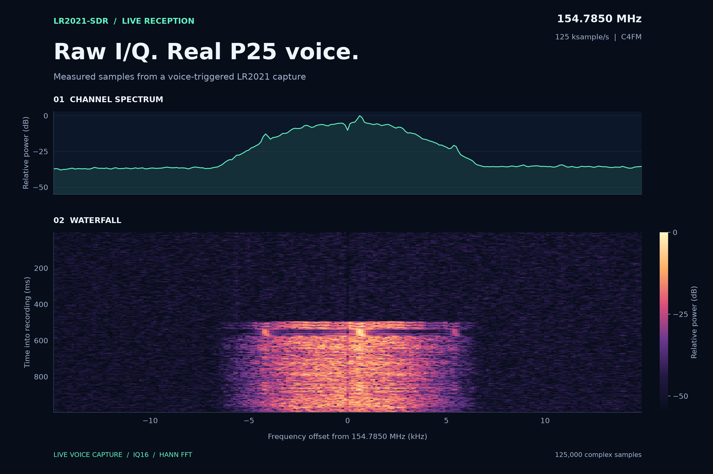

# Raw I/Q to P25 voice



An LR2021 with ROM 1.24 received a P25 Phase 1 C4FM call at 154.7850 MHz through
an external VHF antenna. LakeShark decoded audible voice using its continuous
raw-I/Q path on ESP32-P4. The listener confirmed clear reception.

The recorder taps the same checked IQ16 blocks that feed the live decoder.
A decoded voice event freezes a one-second ring buffer after 200 ms of
post-trigger samples. The saved window includes the call's arrival and voice.
The receiver continued running during capture.

| Recording | Result |
| --- | --- |
| Complex samples | 125,000 |
| Nominal sample rate | 125,000 sample/s |
| IQ16 bytes | 500,000 |
| Export CRC32 | `5FDC4E65`, verified |
| Voice LDUs in offline replay | 3 (2 LDU1, 1 LDU2) |
| IMBE frames played / muted | 27 / 0 |
| Live capture gaps / FIFO loss at snapshot | 0 / 0 |

The saved samples were replayed through LakeShark's LR2021 frontend, C4FM
DSP, P25 decoder and IMBE vocoder. The replay produced PCM audio. Its decoder
reported 56 IMBE bit corrections, no repeated frames and no muted frames.
This is a decode result from the plotted recording, not a signal-only check.

## Reproduce the figures

[voice-spectrum.json](data/voice-spectrum.json) contains the measured FFT bins,
recording checksum and source SHA-256. Raw radio payloads are not included.

```sh
python -m pip install numpy matplotlib
python tools/plot_voice_capture.py
```

The figures use 1024-point Hann windows with a 512-sample hop. DC is removed
per window. The waterfall uses one peak reference across the entire recording;
the mean spectrum uses its own peak reference. No per-row normalization is
applied. Power is uncalibrated. Frequency offsets are relative to 154.7850 MHz.

[Live capture scheduling and measurements](live-streaming.md).
