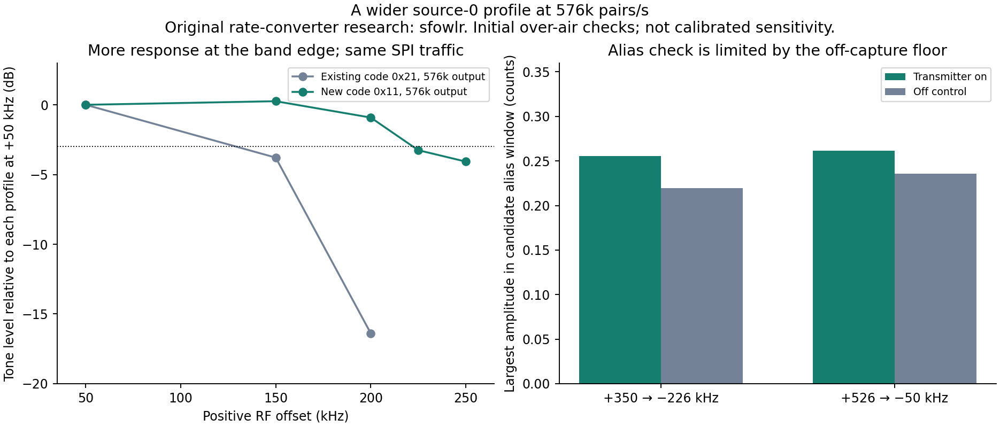

# Wider source-0 profile at the same output rate

[Research index](../../docs/research.md) / Source-0 wider profile

**Credit: [sfowlr](https://github.com/sfowlr) supplied the original LR2021 source-route and rate-converter research.** Their [public W12 notes](https://github.com/RadioFoundry/RadioFoundryGateway/blob/e2a85653aab8ef13a497ed2b8891f102fac711c4/docs/spec/lr2021-iq.md) establish the converter mechanism. The results here are follow-up measurements on LakeShark's LilyGO T-Display-P4 with LR2021 ROM 1.24, not a claim that we discovered source 0 or its converter. Private shared notes and ROM material are not redistributed.

The local experiment uses a faster converter input while retaining **576,000 IQ8 pairs/s output**. At +200 kHz RF offset, the new profile delivered about **15.5 dB more normalized tone response** than the previously used input code, without increasing SPI traffic. This is an initial one-sided passband result, not a calibrated sensitivity or complete bandwidth specification.

## Configuration

| Parameter | Previous profile | New profile |
| --- | --- | --- |
| Raw source | 0 | 0 |
| FSK input code | `0x21` / decimal 33 | **`0x11` / decimal 17** |
| Nominal converter input rate | 800,000 samples/s | 1,333,333 samples/s |
| Requested output | 576,000 IQ8 pairs/s | 576,000 IQ8 pairs/s |
| Input/output ratio | 1.389 | 2.315 |
| Nominal output payload | 1.152 MB/s | 1.152 MB/s |
| Configured SPI clock | 16 MHz | 16 MHz |

The tested new `0x0290` payload, issued under FSK configuration in standby before `SetRx`, is:

```text
11 00 08 CA 00 08 00 00 00 00 01
```

Bytes 1–4 encode 576,000 Hz. Byte 5 selects source 0 and FIFO output. The experiment used the already tested nominal 1024-byte RX FIFO and large DMA reads. Manual RX gain step 8 was applied after `SetRx`, with readback logged. These lab changes were made in a scratch build; **the standalone firmware in this repository has not been updated to expose this profile**.

The local lab commands were:

```text
lora lrlab 915000 fsk 0 17 100 8 discard
lora lrlab 915000 fsk 0 17 3000 8 discard
lora lrlab <center_kHz> fsk 0 17 20 8 hex
```

The older-profile controls substitute input code 33. These commands require the experimental LakeShark build; they are not commands supplied by the standalone firmware here.

## Bounded transport measurements

| Requested duration | Delivered bytes | Elapsed time | Rate from bytes/time | Peak FIFO level | Largest service gap |
| --- | ---: | ---: | ---: | ---: | ---: |
| 100 ms | 115,192 | 100,214 us | 574,730 pairs/s | 296 | 258 us |
| 3000 ms | 3,455,788 | 3,000,050 us | 575,955 pairs/s | 364 | 314 us |
| 3000 ms | 3,455,924 | 3,000,168 us | 575,955 pairs/s | 350 | 304 us |

All three runs returned `ESP_OK`, FIFO flags `0x04`, zero chip errors and successful normal-radio recovery. The two three-second runs are separate sessions. Reported loss flags and byte rates do not prove every sample index was preserved, and these bounded sessions are not a long-duration production-receiver validation.

## Fixed-gain tone comparison

A HackRF One transmitted a finite CW at 915.050 MHz. Only the LR center was moved to create each offset. The final comparison held the transmitter amplitude and RF settings fixed: amplitude argument 64, TX gain zero, RF amplifier off and antenna bias off. Both receiver profiles used manual gain step 8. Each transmitter-on capture had an off control.

Twenty-millisecond captures were analyzed with a Hann-window FFT on the nominal 576k-pair/s axis. Levels are uncalibrated counts, normalized independently to each profile's +50 kHz line. The tests used antennas and independent oscillators.

| Positive RF offset | Input `0x21`, relative to +50 kHz | Input `0x11`, relative to +50 kHz |
| --- | ---: | ---: |
| +50 kHz | 0 dB | 0 dB |
| +150 kHz | −3.79 dB | +0.26 dB |
| +200 kHz | −16.39 dB | **−0.91 dB** |
| +225 kHz | not tested | −3.26 dB |
| +250 kHz | not tested | −4.07 dB |

The new profile retains substantially more response at +200 kHz at the same exported rate. The tested IQ8 components did not reach their clipping boundaries.

Negative offsets, repeated sweeps and calibrated levels remain. A sparse one-sided sweep must not be promoted to a certified 450–500 kHz bandwidth, improved absolute sensitivity or a multi-channel decoder result.



## Alias controls

At 576k output, an external +350 kHz signal would fold to −226 kHz, and +526 kHz would fold to −50 kHz. The largest spectral amplitudes in those candidate windows were:

| External offset | Candidate alias | Transmitter on | Off control |
| --- | --- | ---: | ---: |
| +350 kHz | −226 kHz | 0.255 | 0.219 |
| +526 kHz | −50 kHz | 0.261 | 0.236 |

No clear added alias was established at those input levels. However, the off-capture floor is only about 16 dB below the new profile's +50 kHz reference amplitude. This is **not strong alias-rejection proof**. Stronger blocker tests and calibrated attenuation are required before treating the wider profile as a general scanning or channelization configuration.

## Evidence and limits

[Sanitized numerical results](results.json) include the transport counts, tone measurements and alias controls. Raw RF samples, local filesystem paths, device identifiers, operational settings and privately supplied material are excluded.

The immediate benefit is a candidate wider continuous receive profile at the existing byte budget. Integration still needs longer runs under UI/audio load, both sides of the passband, stronger blockers and known-sequence continuity testing.
