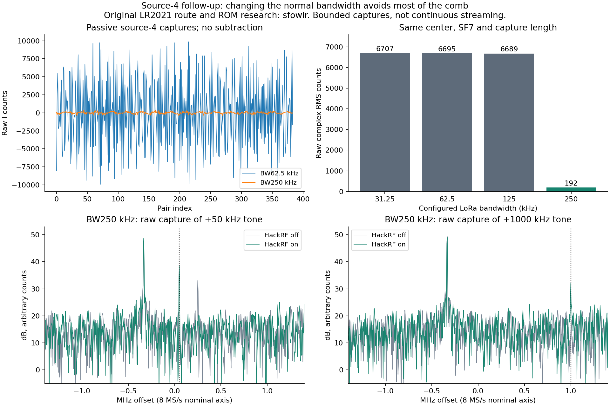

# Finite source-4 SRAM measurements

[Research index](../../docs/research.md) / Source-4 SRAM capture

**Credit: [sfowlr](https://github.com/sfowlr) supplied the original LR2021 source-route, ROM and register research that enabled these experiments.** Their [public W12 notes](https://github.com/RadioFoundry/RadioFoundryGateway/blob/e2a85653aab8ef13a497ed2b8891f102fac711c4/docs/spec/lr2021-iq.md) identify source 4 as a four-byte route that exceeds the ordinary SPI transport rate. Their W12 discoveries and measurements remain theirs. Additional directly shared source material is not redistributed here.

The results below are follow-up measurements on a LilyGO T-Display-P4 with LR2021 ROM 1.24, using an experimental LakeShark build. The standalone firmware in this repository does not implement this source-4 command. This report adds measurements and an offline analysis tool, not a new public firmware mode.

## Finite capture at 915 MHz

An SRAM route captured 8192 bytes, interpreted as 2048 signed low-halfword I and high-halfword Q pairs. The experimental code backs up the selected RAM before capture, checks completion and reported byte count, reads stopped RAM, then resets the radio and restores and verifies every saved word. Normal radio recovery succeeded.

The tested route payload for opcode `0x0290` was:

```text
FF 00 00 00 00 94 00 00 07 FF 00
```

This selects source 4 and the finite SRAM layout read at `0x802000`, with last word index 2047. It is an experimental configuration, not a claim that the region is universally free on other ROM or patch states. Existing capture preflight rejects an active PRAM marker.

A HackRF One tone at 915.050 MHz was independently checked with an RTL-SDR V3 before the source-4 work. LR retunes placed transmitter-on minus matched transmitter-off lines at expected offsets from −1 MHz through +1.75 MHz on a nominal **8 MS/s** axis. Both signs support that rate and orientation. The positive response falls sharply beyond +1.25 MHz, with no clear line established at +2 MHz. Roughly 2 MHz of useful receive width is an initial interpretation, not a calibrated bandwidth or sensitivity measurement.

At that nominal rate, one 8192-byte capture spans **0.256 ms**. Four-byte pairs at 8 MS/s require 32 MB/s before framing; 16 MHz SPI has a 2 MB/s theoretical payload ceiling. **Continuous 8 MS/s streaming is not demonstrated.**

## Repeatable internal component

Eleven archived transmitter-off captures at different center frequencies have minimum centered complex correlation magnitude 0.999351. Their raw complex RMS is about 6700 uncalibrated counts. An external template trained on the other ten captures reduces each held-out capture to 156–172 RMS counts.

In a representative off capture, lag 128 has correlation magnitude 0.999512 and phase −119.991 degrees; lag 256 has about +120 degrees; lag 384 repeats with approximately zero phase. An empirical model is:

```text
p[n] = t[n mod 128] * exp(-j * 2*pi * floor(n/128) / 3)
```

Derotating the common pattern by a carrier at −1/24 cycles per pair makes it almost real, with minor-axis RMS 1.9% of the major axis. This describes the waveform without identifying its physical generator.

The earlier injected tone appears in all sixteen 128-pair blocks of strong-tone captures. That contradicts wholly stale SRAM output, but a full per-location overwrite proof would need a separate sentinel experiment. Discarding the bottom seven bits retains the pattern; it is not simply invalid padding bits.

## Bandwidth changes the pattern

Six new receive-only captures held center and capture length fixed. Each completed capture, RAM restoration and radio recovery successfully.

| Normal LoRa setup | Raw complex RMS counts | Rotating-model residual RMS |
| --- | ---: | ---: |
| SF7, BW31.25 kHz | 6707 | 143 |
| SF7, BW62.5 kHz | 6695 | 147 |
| SF8, BW62.5 kHz | 6699 | 146 |
| SF9, BW62.5 kHz | 6698 | 142 |
| SF7, BW125 kHz | 6689 | 142 |
| SF7, BW250 kHz | **192** | 150 |

The spreading-factor comparison retained the same pattern. It does not support a pattern length that follows spreading factor. BW250 kHz largely avoids the large comb **in the acquired data, without subtraction**, although a smaller spur near −333 kHz remains on the nominal 8 MS/s axis.

Read-only control snapshots before capture recorded `0xF40200 = 0x00006482` and `0xF30124 = 0x0053BD80` for these profiles. The distinguishing captured value was `0xF40204`: `0x2D` for the patterned bandwidths, zero for BW250. Other unrecorded parameters may also change with bandwidth, and these are snapshots before the raw capture's transient RX phase. The association does not establish that this register alone causes suppression.

## Known signal with BW250

HackRF transmitted three finite six-second tones at 915.050 MHz, gain zero, RF amplifier off and antenna bias off. The LR center was moved to produce the offsets below. Each transmitter-on capture had an off control. All three HackRF processes exited with code zero.

These are **raw** spectra without pattern subtraction, using the same Hann-window amplitude convention. Counts and relative line prominence are uncalibrated.

| Intended offset | Peak on nominal 8 MS/s axis | On amplitude | Off amplitude at that bin | Line above nearby median |
| --- | ---: | ---: | ---: | ---: |
| +50 kHz | +50.781 kHz | 86.3 | 5.7 | 24.6 dB |
| +1 MHz | +1.000 MHz | 40.6 | 4.8 | 18.8 dB |
| −1 MHz | −1.000 MHz | 85.1 | 7.0 | 24.3 dB |

The +50 kHz line falls at the nearest bin on a 3906.25 Hz FFT grid. The ±1 MHz results support the nominal rate interpretation but do not directly measure the sample clock.

The tones survive the quieter configuration, but their amplitudes are substantially lower than in earlier BW62.5 captures. Transient gain was not fixed and logged, and RF input was not calibrated. **No sensitivity improvement is claimed.** A controlled fixed-gain comparison is required before treating BW250 as the better receiver profile.



## Offline correction tool

[`tools/source4_correct_offline.py`](../../tools/source4_correct_offline.py) requires NumPy and accepts complete source-4 console logs. It verifies sequential indices, byte count, capture success, restoration and recovery. It opens no hardware. It writes a new NPZ containing raw samples, model, corrected samples and provenance; existing output files are refused.

External quiet-template subtraction does not fit amplitude or phase to the signal-bearing input:

```text
python tools/source4_correct_offline.py ON.txt --baseline OFF1.txt OFF2.txt --out corrected.npz
```

Validate template stability across gain, configuration, temperature and restarts. Do not subtract a patterned-bandwidth template from a BW250 acquisition.

A separate single-capture rotating-fold diagnostic estimates the repeating component from its own input:

```text
python tools/source4_correct_offline.py ON.txt --method fold128 --out folded.npz
```

This also erases real signals in the fitted subspace, at `f/Fs = (integer - 1/3)/128`. Synthetic tests retained 99.61% of coherent amplitude at several tested nominal tone offsets, but erased tones at +41.6667 kHz and +1.7916667 MHz. It is not transparent general-purpose correction. Keep the raw samples.

## Scope and evidence

The [sanitized numerical results](results.json) contain capture hashes, aggregate measurements and recovery outcomes. Raw RF captures, private shared notes, ROM images, device identifiers, local filesystem paths and operational logs are excluded.

The normal firmware and stored receive configuration were restored after each test session, with transmission disarmed. No source-4 RF-event trigger, pretrigger history, additional protocol decoder, or continuous high-rate transport is established by these measurements. The existing console command starts finite acquisition through `SetRx`.
