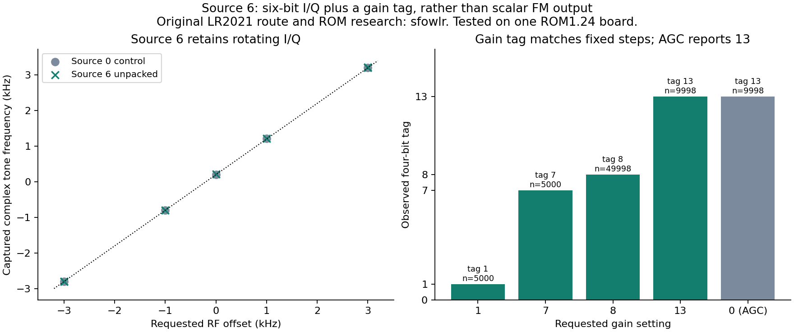

# Source 6 carries gain-tagged IQ in the tested configuration

[Research index](../../docs/research.md) / Source-6 classification

**Credit: [sfowlr](https://github.com/sfowlr) supplied the original LR2021 route and ROM research that enabled these tests.** Their [public W12 notes](https://github.com/RadioFoundry/RadioFoundryGateway/blob/e2a85653aab8ef13a497ed2b8891f102fac711c4/docs/spec/lr2021-iq.md) describe source 6 as an unresolved two-byte route. The measurements below are local follow-up on LakeShark's LilyGO T-Display-P4 with LR2021 ROM 1.24. Private notes and ROM material are not redistributed.

**Source 6 was not a scalar FM/FSK discriminator in this configuration.** Its bytes instead contain two signed six-bit IQ components and a four-bit field that tracks gain. Known FM and FSK signals recover through software IQ demodulation, not by treating its words as already-demodulated frequency samples.

## Setup

The experimental classifier used FSK input code `0x1C`, nominal 125k input samples/s, and an explicit 50k output rate. The input/output ratio is 2.5. The `0x0290` payload was:

```text
1C 00 00 C3 50 0E 00 00 00 00 01
```

The source-0 IQ control used the same settings with byte 5 changed from `0x0E` to `0x08`. Readback confirmed `0xF30144 = 0xFA000000`. Captures were bounded, at most 100 ms, with raw bytes saved before interpretation and explicit radio recovery afterward.

The underlying FSK modem setup used 10 kbit/s and 5 kHz deviation; the explicit route sets the converter output independently. Manual gain was applied after `SetRx` and read back. Calibration preceded FIFO relocation and acquisition, using the nominal 1024-byte RX FIFO.

The local command was `lora lrscalar <center_kHz> <0|6> <milliseconds> <gain>`. It requires the experimental classifier build; **the standalone firmware in this repository does not expose this command**.

## Observed word layout

For each two-byte source-6 word, the tested interpretation is:

```text
I = signed(byte0) >> 2
Q = signed(byte1) >> 2
gain = (byte0 & 3) | ((byte1 & 3) << 2)
```

The shifts are arithmetic. The lower two bits of each byte carry the gain field rather than additional IQ precision. At commanded manual gain steps **1, 7, 8 and 13**, every captured tag matched that step. With chip AGC requested using argument zero, the captured tag was **13**, so the field is not merely an echo of the command argument.

After unpacking, source-6 tone locations, amplitudes and noise distributions closely resemble the source-0 control. These observations support gain-tagged IQ6+IQ6 packing, not additional ADC resolution. The [offline tool](../../tools/lr2021_source6.py) implements the interpretation without opening hardware.

## Frequency and modulation controls

At gain 8, a finite CW was placed at offsets −3, −1, 0, +1 and +3 kHz, with additional signal-level controls. Interpreting the bytes as complex IQ produced a frequency-versus-offset fit with **R² above 0.99999**, including about +200 Hz of oscillator offset. Interpreting each word as either little-endian or big-endian signed int16 produced scalar means with **R² below 0.06** against frequency.

A generated 2-FSK fixture used 2 kbaud, ±3 kHz deviation and a known repeating bit pattern. Software IQ demodulation recovered:

| Route and interpretation | Wrong symbols / compared symbols |
| --- | ---: |
| Source 0, software IQ demodulator | 4 / 199 |
| Source 6, unpacked IQ plus software demodulator | 6 / 199 |
| Source 6, raw int16 threshold searches | approximately 37–39% errors |

The searches fitted timing, frame offset and polarity. These are exploratory symbol-match results, not certified BER or a complete protocol decoder.

A separate FM fixture carried a 1 kHz modulation tone. A **software** IQ discriminator recovered a peak at about **1000.21 Hz** from both routes. Neither result demonstrates hardware FM demodulation or a reduction in host discriminator work.

[`generate_known_fsk.py`](generate_known_fsk.py) generates the known FSK and FM IQ8 fixtures and reference metadata. It opens no hardware. The tests used finite three-second HackRF transfers at 2 MS/s, with RF amplifier and antenna bias disabled.



## Useful result and remaining limits

The gain tag could support gain-aware recordings and analysis, with IQ and a gain label in each two-byte word. Exact dynamic gain-transition timing, calibrated amplitude reconstruction and behavior on other boards or configurations remain unverified.

[Sanitized results](results.json) contain the aggregate checks. Raw RF captures, private material, device identifiers and operational settings are excluded. Source 6's demonstrated result here is **gain-tagged IQ**, not native FM/FSK output.
